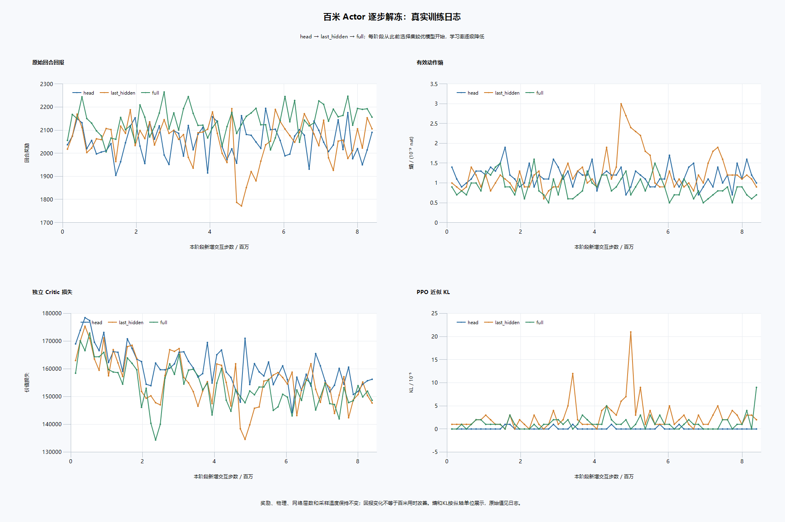

# 百米 Actor 逐步解冻实验（2026-10-15）

本轮最好原生成绩 **33.033333 秒、991 帧**，未突破外部 XYF 991 帧示范。最佳随机搜索与确定性模型表现分别记录，不能相互冒充。

## 修改与目的

生产代码仅修改 `scripts/train_ppo.py`：增加 `actor_unfreeze=none/head/last_hidden/full` 配置、CLI 和明确的分层冻结覆盖逻辑。`none` 保留旧冻结行为，模型结构和推理不变；有独立 Critic 才允许解冻，目前限定百米任务。解冻发生在读取旧 checkpoint 及旧局部残差冻结逻辑之后，避免旧残差重新锁住 Actor。

原 PPO、GAE、采样缓冲区、专家辅助损失和日志继续沿用。奖励函数、原生物理、计时、网络宽度/深度、logits 温度及示范数据均未改变。各阶段采用更小的 Actor 学习率，Critic 仍独立更新。此为渐进可行性试验，学习率也随阶段变化，不能把阶段差异全归因于解冻层数。

`head` 开放全程输出层，仍保留已有局部残差，共 8,224 个策略参数；`last_hidden` 再开放最后一层特征，共 74,016 个；`full` 再开放输入特征与角速度分支，共 634,400 个。各阶段独立训练64次更新，每次128环境×1024步。

新配置位于 `configs/ppo_classic_unfreeze_*_20261015.json`；验证目录的编排脚本用于分阶段续训、冻结检查、模型选择和报告，实际训练仍调用原训练入口。

## 验证与选择

已检查默认模式推理输出与修改前逐值一致；梯度隔离、冻结层不变和开放层实际更新均经过检查。每阶段先跑4环境×1024步×2更新的小测试，再严格加载 checkpoint 和完整原生运行。有限观测、奖励、损失及模型参数均检查通过。

整网解冻初始学习率3e-6的小测试在370帧失败，KL限制被触发；这属于训练行为退化，数值未溢出。保留其日志、配置及权重后，从安全的第二阶段模型重新开始，把学习率降为3e-7，小测试恢复991帧完赛，才启动正式整网训练。未通过删除核心功能规避失败。

阶段选择种子固定为2026101551，每个候选64个环境的首回合；优先原生确定性完赛、帧数、随机成功次数及成功平均用时。存在至少32/64成功候选时使用该门槛。若训练退化，允许保留进入该阶段前的模型，避免强制选用较差末次权重。此选择集样本较小，最终另做独立留出评测。

| 阶段 | Actor学习率 | 新增交互 | 正式训练秒 | 阶段所选帧数 | 选择集完赛 |
| --- | ---: | ---: | ---: | ---: | ---: |
| head | 3e-05 | 8,388,608 | 308.0 | 991 | 58/64 |
| last_hidden | 1e-05 | 8,388,608 | 310.3 | 991 | 61/64 |
| full | 3e-07 | 8,388,608 | 311.2 | 991 | 62/64 |

包含四次小测试（含整网学习率重试），新增 PPO 交互共 **25,198,592**，PPO进程共 **16.13 分钟**。从首次备份代码至报告约 **26.16 分钟**。随机搜索 **16,384** 个完成回合，按原作者异步方法执行，其成功比例不作为独立评测成功率。实验各分支总交互数不能全部算到所选模型；其累计计数 global_step 为 **35,651,584**。

## 独立留出评测

模型选择完成后固定权重，种子2026101561/62/63各64个首回合。初始状态固定，仅动作采样随机，因此不代表不同初态的鲁棒性。

| 指标 | 本轮开始前模型 | 本轮保留模型 |
| --- | ---: | ---: |
| 完赛 | 181/192 | 187/192 |
| 完赛率 | 94.27% | 97.40% |
| 成功平均时间 | 33.033333秒 | 33.033333秒 |
| 最好时间 | 33.033333秒 | 33.033333秒 |
| 快于991帧 | 0 | 0 |

本轮最终选择使用本轮训练候选。所选来源：`E:\Work\强化学习小项目\QWOP_rl_training_public\checkpoints\ppo_classic_unfreeze_full_20261015_update_000288.pt`。

## 保存与解释边界

- 保留模型：`E:\Work\强化学习小项目\QWOP_rl_training_public\checkpoints\ppo_classic_actor_unfreeze_best_20261015.pt`，附原始示范来源、阶段选择与训练配置。
- 确定性回放：`E:\Work\强化学习小项目\QWOP_rl_training_public\replays\classic_actor_unfreeze_greedy_20261015.bin`，严格重载动作一致，二进制CRC验证通过，模型已在完整原生规则下运行。
- 与原BC回放字节完全相同，991个动作一致，不能作为新纪录。
- 原百米模型、BC权重及原生物理DLL哈希与本轮开始前相同；未改动跳远模型，未自动提交Git。
- 单条示范、奖励目标和采样分布仍保留，因此若无突破，只能说明这组渐进解冻方案尚未找到更快策略，不能证明示范最优或解冻无效。
- 示范状态诊断显示，完整输出原991个规范动作的估计概率从89.40%升至94.62%；两模型在991个示范状态的最大概率动作都没有改变。这是沿示范状态的诊断值，真实完赛率见独立评测，二者不能混用。
- `*_selection.json` 包含逐模型结果、专家状态动作变化/KL及参数变化；`heldout_comparison.json` 是未用于模型选择的独立评测。

