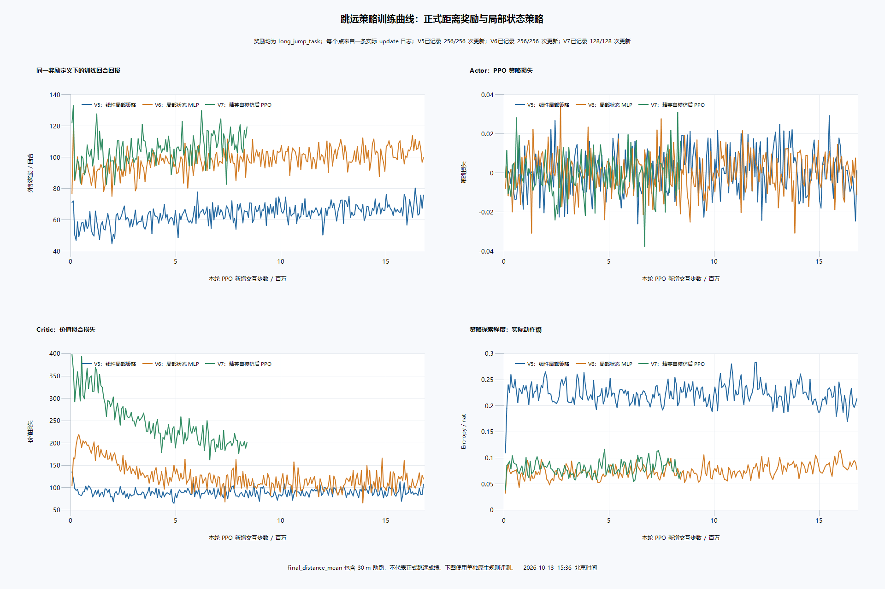
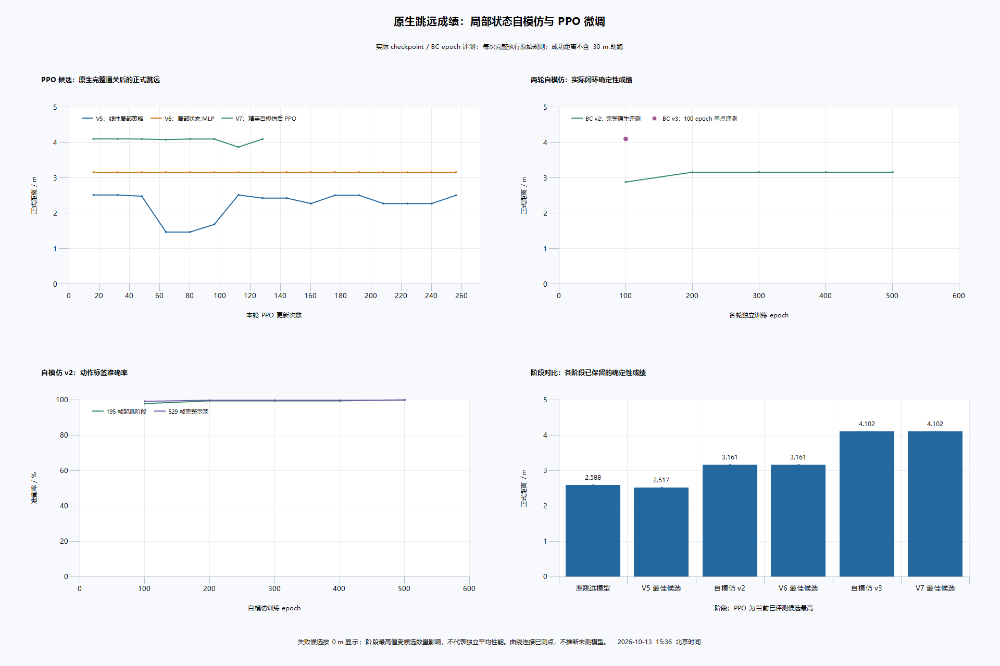

# 跳远距离优化实验：局部状态策略、自模仿与 PPO

本轮将自主确定性跳远从 **2.588184 米提高至 4.099180 米，提升 58.38%**。最终模型在独立 192 次随机评测中，成功回合平均距离从 **1.471510 米提高至 3.041295 米**；原生成功率基本持平，分别为 155/192 和 154/192。正式计分、物理、30 米助跑、9 米沙坑和退出规则保持不变。

## 已保存的结果

- 最终模型：[long_jump_distance_elite_best_20261013.pt](../checkpoints/long_jump_distance_elite_best_20261013.pt)。来源为 V7 update96，包含模型、优化器、实际配置及选择来源。
- 确定性回放：[4.10 米](../replays/long_jump_distance_elite_deterministic_4p10m_20261013.bin)，准确成绩 4.099179745 米，504 帧，16.800 游戏秒，完整成功退出沙坑。
- 最佳随机回放：[4.13 米](../replays/long_jump_distance_elite_sampled_best_20261013.bin)，准确成绩 4.130292892 米，494 帧，16.467 游戏秒；来自最终模型的 2048 次随机搜索，1675 次成功。
- 旧模型、旧 3.16 米回放和百米模型均保留。

回放为原有二进制格式，CRC、规则编号、完整原生重放与最终成绩均已验证。可在 https://run.lyihub.com/ 的跳远模式导入。回放文件是动作记录，不是视频文件。

## 瓶颈与证据

原奖励约有 30 点助跑反馈，而 2.59 米跳远仅得到约 12.94 点距离奖励，另外还有落地后行走反馈。奖励回报容易受助跑和出沙坑过程影响，因此不能用回报上升直接判断正式跳远是否变远。

原策略已有可用助跑，主要余量在起跳后脚部位置及接触时机。对原生轨迹的检查区分了后端 jumped 标志和双脚真正离地，且使用最终正式分数，不使用含助跑的 distance 或首次落地最高分。

| 轨迹指标 | 原确定性策略 | 自模仿 v2 | 自模仿 v3 |
| --- | ---: | ---: | ---: |
| 正式跳远 / 米 | 2.588184 | 3.160730 | 4.101658 |
| 前 25 米耗时 / 游戏秒 | 11.133333 | 11.133333 | 11.133333 |
| 双脚无接触时间 / 游戏秒 | 0.633333 | 0.833333 | 1.100000 |
| 空中躯干前移 / 米 | 1.804182 | 2.439731 | 3.315686 |
| 峰值躯干高度比 | 1.001188 | 1.112664 | 1.095763 |
| 落地后正式距离损失 / 米 | 0 | 0 | 0 |

v2 与 v3 的离地时刻和速度相同，首次动作差异在离地后的第 392 帧。原 v2 第 408 帧右脚接触沙坑，v3 此时右脚中心更高约 0.144 米，继续悬空至第 416 帧。脚部接触推迟 8 帧、约 0.267 秒，正式距离增加约 0.941 米。该轨迹对应空中摆腿、收放腿与落地时序改善；没有将某一个动作的独立因果贡献拆出来。

躯干峰值高度反而略低，故没有加入强制跳高、固定前倾 5°或压低上下运动的奖励。跑步姿态约束不宜直接套到跳远腾空阶段。

## 小范围代码修改

| 文件 | 本轮修改 | 原因与训练影响 |
| --- | --- | --- |
| src/reward_profiles.cpp、src/reward_profiles.h | 新增 long_jump_task 奖励及独立距离势函数状态 | 强调最终正式距离；reset 清空状态；旧 long_jump_30m 奖励保留 |
| src/course_rules.h、src/course_rules.cpp、src/python_module.cpp | 注册新奖励名称并映射现有 LongJump30m 规则 | 配置可选择新奖励，原生场地与计分不变 |
| scripts/train_ppo.py | 可选局部状态 MLP、配置及加载支持，检查新奖励 gamma=.999 | 为起跳阶段提供可训练的身体状态表示；默认关闭，旧 checkpoint 行为保持 |
| scripts/train_replay_imitation.py | 在已有自模仿训练中支持跳远、冻结助跑及训练局部 MLP | 将本地自身策略的有效探索动作学入观测条件策略，保留原百米流程 |

沿用作者 PPO、GAE、rollout buffer、16 个动作、68 维原始观测、Actor/Critic 主体、日志和 checkpoint。新分支输入为最新 68 个归一化状态和 12 个角速度，结构为 **80→128→Tanh→16**。末层零初始化；仅在起跳线前 5 米起生效，并与原线性调整层相加。原跑步特征、Actor、角速度主干和观测缩放冻结；Critic 独立训练。

训练开始前确认：零新分支保持 529 帧示范和原 472 帧完整轨迹输出一致；非零新分支仍保留前 25 米的 334 帧输出；阶段外梯度为零，阶段内梯度有限；严格保存加载一致。模型推断每帧读取当前观测并运行网络，没有动作表、回放控制器或按帧硬编码动作。

新增配置放在原 configs 系统内。验证辅助文件放在项目目录的 verification/jump_improvement_20261013，因为首落地、正式最终距离和退出沙坑需要独立于训练回报进行审计；它们调用原环境、训练入口和回放工具，没有替代训练架构。

## 新奖励定义

令 P 为最多 30 米的助跑新进度，D 为原生有效跳远距离，均采用米为单位：

```
普通进度：0.2 × 新增助跑进度
成功完整退出：10 + 40 × 最终正式距离 D
失败或超时：-30（优先于成功奖励）
势函数：Phi = 8 × 当前有效距离；终止状态 Phi = 0
逐步塑形：F = 0.999 × Phi(next) - Phi(previous)
```

距离按原 9 米沙坑范围截断。F 加在上述基础奖励上，训练 gamma 固定 .999。完整回合的折扣塑形和理论上为零；原生浮点实测残差小于 0.00006。它提前提供距离变化反馈，同时在距离回退或失败时撤回，避免只奖励首次较远触地而忽略最终扣分。相关形式见 [Ng、Harada、Russell，1999](https://ai.stanford.edu/~ang/papers/shaping-icml99.pdf)。策略不变性仅指相对于本轮基础奖励的势函数塑形；本轮基础目标本身已重新加权。

不另奖励沙坑内行走、持续悬空或指定身体角度。成功仍必须满足原生完整退出条件。reset、距离下降、失败、45 秒超时及旧规则一致性测试均通过。

## 实验过程与效果

| 阶段 | 方法 | 确定性成绩 | 实测训练进程耗时 |
| --- | --- | ---: | ---: |
| 原模型 | 本轮保留基线 | 2.588184 米 | — |
| V5 | 新奖励，原线性局部层，256 PPO 更新 | 最佳 2.517139 米 | 381.409 秒 |
| 自模仿 v1 | 仅原线性局部层学习自身 3.16 米示范 | 最佳 2.517139 米 | 8.674 秒 |
| 自模仿 v2 | 加局部 MLP，500 epoch 学习自身 3.16 米示范 | 3.160730 米 | 4.774 秒 |
| V6 | v2 后续 256 PPO 更新 | 3.160730 米 | 424.609 秒 |
| 自模仿 v3 | 从 v2 的 2048 次探索中选 4.10 米回放，100 epoch 学习 | 4.101658 米 | 1.723 秒 |
| V7 | v3 后续 128 PPO 更新 | 最终选中 4.099180 米 | 219.907 秒 |

第一轮奖励修改与原线性层自模仿没有产生距离突破，保留为失败实验记录。新增局部状态表示后，自身有效示范才被完整学会。PPO 主要进一步改善随机平均表现，而不是产生全部确定性距离增益。因此本轮属于 **自模仿 + PPO**，不归因于单独增加距离奖励或单独 PPO。

正式 PPO 共 128 环境、16 原生线程、512 步 rollout、4 epochs、8 minibatches；每次采集 65,536 个转移，minibatch 8192。gamma=.999、GAE lambda=.995、clip=.2、KL 上限 .01；Actor 和 Critic 学习率均 1e-4，vf_coef=.1。V7 熵系数从 .001 降至 .0003，每 16 个更新保存。已有有效动作后采用温和探索，减少破坏起跳的随机错误。每个新阶段先用 Actor 学习率 0、Critic 3e-4 校准 16 更新；RND 本轮关闭。

两次四环境最小训练共 16,384 个转移，检验有限观测、动作、奖励、损失、reset 和 checkpoint。全部实验共 **43,532,288 个新 PPO 转移**；PPO 进程累计 1112.344 秒，三个自模仿实验累计 15.170 秒，合计 **1127.515 秒，约 18 分 48 秒**。这些时间不含源码阅读、构建、随机搜索及评测。实验分支总量不能当作最终模型累计训练量：最终选中 V7 update96，当前新阶段 global_step=5,767,168（Critic 校准 + V7 的 80 次 PPO 更新）。

## 独立评测与模型选择

先用选择种子 2026101311 的 64 个首回合，根据失败按 0 的整体均值选择策略，并要求确定性原生成功且距离至少 4 米。选中 V7 update96，不直接采用末次 checkpoint。之后固定最终模型，用预留种子 2026101321/22/23，各 64 回合评测；没有据留出结果继续挑选或修改模型。

| 192 次留出评测 | 原基线 | 最终模型 |
| --- | ---: | ---: |
| 原生成功 | 155/192，80.73% | 154/192，80.21% |
| 成功回合平均 / 米 | 1.471510 | 3.041295 |
| 成功回合中位数 / 米 | 1.537856 | 3.761099 |
| 失败按 0 的整体平均 / 米 | 1.187937 | 2.439372 |
| 至少 3 米的回合 | 0 | 93 |
| 最佳 / 米 | 2.634412 | 4.130190 |

20,000 次回合 bootstrap，固定种子 2026101324：最终整体平均的 95% 区间 [2.205859, 2.674875] 米；相对基线均值增加 1.251435 米，独立双组重采样差值区间 [0.977919, 1.525286] 米。距离明显提升，成功率没有提高。评测从相同原始初态出发，仅动作随机，不能据此声称不同初始姿态下的鲁棒性。

最终 2048 次搜索最好 4.130293 米，原记录同为 2048 次搜索的 3.160730 米。最好值是搜索极值，不等于平均性能；完整平均评测如上。

## 训练图与验证文件





图中全部点来自实际日志或原生评测，未合成曲线。不同轮次的初始化不同；训练回报比较仅使用 long_jump_task。训练日志 final_distance_mean 包含 30 米助跑，不能充当正式跳远成绩。Critic loss 仍有波动，没有将其描述为完全收敛。

验证目录 ../../verification/jump_improvement_20261013 中保存 reward_validation.json、jump_state_validation.json、self_imitation_v2/v3_native_audit.json、elite_selection64_comparison.json、final_model_artifacts.json、final_model_native.json、baseline_heldout192.json、final_heldout192.json、各轮日志/耗时及图表来源。最终模型 SHA256 为 4a7178d6c97e26c8674f52ccf0d8aa7d31e845915267deced2dedf7f9498cd37，旧模型与原物理 DLL 哈希不变。

## 当前状态与下一步

已完成距离奖励调整、小网络验证、自身示范学习、PPO 微调、独立评测及回放保存。当前主要未解问题是约 20% 随机失败，以及落地后的低姿态恢复；原生接口没有膝盖接触标志，躯干低不能直接当作膝盖触地检测。后续优先诊断失败发生在助跑还是落地，扩充多条有效与恢复示范；有必要时再局部解冻起跳前助跑段，配合独立评测检查速度收益，而不一次放开整个跑步网络。
