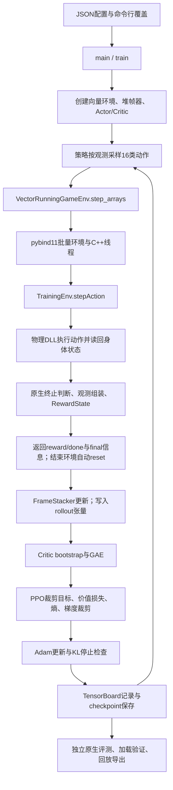

# 基于深度强化学习的 QWOP 运动控制与策略优化研究

*Deep Reinforcement Learning for Motion Control and Policy Optimization in QWOP*

> 记录范围：从原项目分析、Windows 环境准备和 baseline，到百米奖励迭代、50/45/43 秒实验、RND、公开影子示范模仿，以及百米策略迁移到跳远。结果截至 2026-10-11；依据本地源码、Git 历史、TensorBoard 日志和原生评测报告整理。
>
> 文中的“已经完成”“实际观测”“后续建议”分开表述。没有记录的结果不补造；失败实验也保留。曲线均由真实记录生成，详细来源见各实验条目和末尾证据索引。

## 1. 项目目标与当前成果

本项目在 [LYiHub/QWOP_rl_training_public](https://github.com/LYiHub/QWOP_rl_training_public) 的基础上，训练神经网络控制 Q/W/O/P 按键，研究百米速度、运动姿态、探索、奖励设计和跨任务迁移。最终产物包括可加载的模型权重、训练日志、原生评测结果和可在 [游戏回放网站](https://run.lyihub.com/) 播放的动作回放。

| 路线 / 产物 | 已验证成绩 | 结果的真实来源 |
| --- | ---: | --- |
| 防持续低姿态的早期百米 v3 | 75.27 秒 | PPO 训练，确定性运行 |
| 微前倾和后仰约束 v4 | 65.63 秒 | PPO 训练，确定性运行 |
| 首个低于 50 秒的模型 | 49.97 秒 | PPO 训练后进行 Actor 偏置局部参数搜索；纯 PPO 最好 50.17 秒 |
| 首个低于 45 秒的模型 | 44.97 秒 | PPO 训练后进行 Actor 偏置搜索；该阶段纯 PPO 最好 45.70 秒 |
| 保留的最快独立 RL 路线模型 | 44.93 秒 | 已有 PPO 模型后进行小幅网络偏置搜索，不是未经修改的 PPO 快照 |
| 该路线已核实的纯 PPO 候选 v33 | 45.40 秒 | PPO 快照；43 秒目标未达成 |
| 网站影子示范行为克隆模型 | 33.03 秒 | 本地网络模仿外部冠军 XYF 的 991 帧示范，固定初始状态确定性复现 |
| 同一 BC 模型的不同随机回放 | 33.13 / 33.17 秒 | 降低采样温度并筛选真实通关回合；权重未改动 |
| 首轮跳远 PPO | 确定性 2.60 米；随机最佳 2.80 米 | 从旧百米模型迁移训练；随机最好回放经筛选 |
| BC 百米策略迁移后的跳远 | 确定性 2.59 米；随机最佳 **3.16 米** | 继承助跑、PPO 训练起跳附近调整层；3.16 米是 2048 次随机运行中的最好结果 |

**当前最好跳远回放比此前 2.80 米提高约 12.8%，但确定性跳远成绩没有超过旧 2.60 米。百米 33.03 秒属于示范学习成果，不应表述为独立 PPO 自行探索出的冠军成绩。**


### 1.1 四种必须区分的指标

1. **训练奖励**：由当前 reward profile 定义，改变奖励规则后，其数值单位和排序可能改变。
2. **原生游戏成绩**：百米用时、跳远正式落点距离，来自原物理环境和终止规则。
3. **确定性结果**：每步选最大概率动作，验证模型能否稳定复现一条轨迹。
4. **随机最佳与随机平均**：前者受搜索次数影响；后者也必须同时报告成功率，因为仅统计成功回合会排除失败。

相同初始条件的 16 次确定性复跑，是保存/加载与执行的一致性检查，不是 16 种初始姿态下的泛化验证。参数搜索改变的是模型权重；动作采样搜索只选择回放，不改变模型。这两类搜索不应混写。

## 2. 开发环境、仓库结构与职责

工作目录：`E:\Work\强化学习小项目`。仓库目录：`E:\Work\强化学习小项目\QWOP_rl_training_public`。仓库外的 `verification` 存放辅助验证、诊断、报告和本次图表生成材料。

### 2.1 实际开发环境

| 项目 | 本地已验证配置 |
| --- | --- |
| 操作系统 | Windows 11，64 位 |
| GPU | NVIDIA RTX 5070 Ti，约 15.92 GiB 可见显存 |
| 内存 / CPU 并行度 | 48 GiB 内存，24 个逻辑处理器 |
| Python | 3.10.11；项目虚拟环境 `.venv` |
| 训练库 | PyTorch 2.11.0+cu128、NumPy 2.2.6、Gymnasium 1.4.0、TensorBoard 2.21.0 |
| 构建工具 | CMake 4.4.4、Visual Studio Build Tools 2022、MSVC 14.44、Windows SDK 10.0.26100 |
| 软件位置 | Python、Git、CMake、Build Tools 主体位于 `E:\Program Files`；微软安装器及部分 Windows SDK 使用系统注册位置 |

完整安装与根因处理见 [环境验证记录](E:/Work/强化学习小项目/verification/baseline_report.md)。本次写报告没有重新安装软件，没有运行新训练，也没有修改训练代码。

### 2.2 结构总览

```text
E:\Work\强化学习小项目\
├─ QWOP_rl_training_public\
│  ├─ README.md / requirements.txt / CMakeLists.txt
│  ├─ src\
│  │  ├─ training_env.cpp / .h          原生环境step/reset、观测和终止
│  │  ├─ course_rules.cpp / .h          模式、赛道参数、奖励profile映射
│  │  ├─ reward_profiles.cpp / .h       各任务奖励及跨步状态
│  │  ├─ physics_backend_api.h          物理DLL的C ABI
│  │  ├─ physics_backend_loader.cpp/.h  载入物理后端
│  │  └─ python_module.cpp             pybind11及批量环境线程接口
│  ├─ scripts\
│  │  ├─ build.py / check_environment.py
│  │  ├─ running_env.py                Python环境封装
│  │  ├─ train_ppo.py                  PPO主入口、网络、GAE、日志、checkpoint
│  │  ├─ distill_policy.py             已有教师模型到学生模型的蒸馏
│  │  ├─ train_replay_imitation.py     新增：动作回放到行为克隆模型
│  │  ├─ export_policy_replay.py       模型执行与动作回放导出
│  │  ├─ search_policy_best.py         随机运行并选最佳回放
│  │  └─ replay_io.py                  回放格式、动作打包、CRC
│  ├─ configs\                        作者示例及各独立实验JSON
│  ├─ checkpoints\                    模型、优化器、配置、训练计数
│  ├─ runs\                           TensorBoard训练日志
│  ├─ replays\                        Q/W/O/P二进制动作回放
│  ├─ bin\                            running_physics.dll及编译的Python扩展
│  ├─ docs\                           阶段记录、ABI说明和验证报告
│  └─ third_party\pybind11\           绑定依赖，非本项目RL算法
└─ verification\                      本地诊断、独立评测、边界测试和证据
   ├─ shadow_audit\                    外部示范来源、BC和随机回放验证
   └─ project_report\                  本报告证据汇总及图表生成材料
```

原项目属于“开放训练源码 + 单独授权的预编译物理后端”。身体动力学的全部实现不在这个仓库里；物理来自 DLL。仅在头文件声明新碰撞字段，不会使 DLL 自动提供膝盖接触或各部件质量信息。许可说明见仓库 README、LICENSE 和 `bin/running_physics.LICENSE.txt`。

### 2.3 通用算法与任务耦合部分

| 通用且尽量保留 | 与 QWOP / 具体项目相关 |
| --- | --- |
| PPO-Clip损失、GAE、Adam、梯度裁剪 | 16个按键动作及其优先级 |
| rollout张量buffer、minibatch迭代 | 身体68/66维观测、单位和接触标志 |
| Actor/Critic主体及可选独立Critic | 躯干高度、头躯干角度、起跳线距离等特征索引 |
| TensorBoard日志、checkpoint框架 | 赛道、原生失败/成功、奖励函数 |
| JSON配置覆盖、模型导出流程 | 跳远阶段探索、按任务区分的成绩排名 |

迁移任务的优先修改面是 observation、action、reward、reset、step、termination 和配置；但本项目已经内置百米、跨栏和跳远，因此切换到跳远优先使用已有模式，而不是新建一套环境或重写算法。

## 3. 环境、动作、观测与正式成绩

### 3.1 三种原生模式

| 模式 | 原始观测 | 场地与约束 | 正式目标 |
| --- | ---: | --- | --- |
| `classic_100m` | 68维 | 百米场地，50米处有真实障碍，120秒上限 | 按原生成功条件完成，时间越少越好 |
| `hurdle_110m` | 66维 | 内置110米跨栏场地 | 成功完成用时 |
| `long_jump_30m` | 68维 | 30米助跑、9米沙坑、45秒上限 | 正式跳远落点距离越大越好；有效通关要求走出沙坑 |

跳远完成后，`info.distance` 通常是 `30 + 正式跳远长度`。训练日志显示约 32 米，并不表示跳了 32 米。原生落点分数在接触后可能继续变化，所以选模型和回放时使用**最终官方分数与通关状态**，不能只取首次落地的一帧。

### 3.2 观测的含义

百米和跳远均有 12 个身体部件，每个部件 5 个值：相对视点的 x、y、角度、vx、vy，共 60 维。后面 8 维是任务信息。

| 索引 | 百米 | 跳远 |
| --- | --- | --- |
| 0～59 | 12部件的几何和速度 | 身体布局相同 |
| 60 | score / 前进分数 | score；落地后其含义会随原生模式变为跳远分数 |
| 61 | 原生游戏时间 | 原生游戏时间 |
| 62 | 障碍相对距离 | 起跳线相对距离 |
| 63 | 终点/沙坑相对距离 | 沙坑末端相对距离 |
| 64 / 65 | failed / jumped | failed / jumped |
| 66 / 67 | 左右脚接触地面 | 左右脚接触地面 |

**shape相同不等于语义相同。**这正是最新跨任务迁移必须先校准输入原点的原因。

固定缩放保存在 checkpoint 中：身体项常用 `[5, 15, π, 10, 10]`；百米任务项常用 `[100,120,1000,1000,1,1,1,1]`。新建跳远模型有专用任务尺度，但迁移旧模型时保留已有归一化，避免把已学特征的输入单位直接换掉。

堆叠历史从早期1/2帧发展到8/32帧。32×68=2176维，约覆盖1秒历史。reset时重复初始观测填满历史，避免把上一回合的帧拼进新回合。

### 3.3 按键与有效动作

模型输出 16 个离散动作 logits，动作是 Q/W/O/P 的4位掩码。配对原生执行验证了以下9类物理等价动作：

```text
[0] [1,3] [2] [4,12] [5,7,13,15] [6,14] [8] [9,11] [10]
```

对冲按键中 Q 优先于 W，O 优先于 P。因此“16类动作熵增大”未必代表真实身体控制更丰富；可能只是等价掩码之间切换。有效动作熵只合并概率来计算熵奖励，PPO采样和新旧概率比仍保留原16类接口。BC标签的规范化还在外部专家的全部991帧上验证了观测、奖励、info和终止标志完全一致。

### 3.4 计时和回放

原生回放按30个游戏帧对应1秒计时：991帧约33.03秒，994帧约33.13秒，995帧约33.17秒。游戏时间不等于电脑实际训练用时。

`.bin` 是按键动作序列，不是 MP4 录像。格式包括14字节头、规则编号、动作数、CRC，以及每字节打包两个4位动作。回放规则编号：百米1、跨栏2、跳远3；跳远物理后端的模式值2与回放规则3不是同一个编号体系。

早期回放到120秒停止，对应原生百米时间上限或回合结束。判断具体停止原因应看该回放的最终success、failed、truncated及动作数，不能凭画面断言模型突然停止学习。

## 4. 使用的算法及在代码中的实现

### 4.1 PPO-Clip与GAE

真正的强化学习入口是 [train_ppo.py](E:/Work/强化学习小项目/QWOP_rl_training_public/scripts/train_ppo.py) 的 `main → make_config → train`。项目自行实现离散动作 PPO，不是调用 Stable-Baselines3；当前训练没有使用 SAC 或 TD3。

Actor输出按键分布；Critic预测未来回报。原始网络共享128×128 Tanh表征，后续扩展为256×256，部分实验改用独立Critic特征，保护Actor的步态学习。

PPO用新旧动作概率比约束策略更新：

$$
\rho_t=\frac{\pi_\theta(a_t\mid s_t)}{\pi_{\theta_{old}}(a_t\mid s_t)},\qquad
L_{clip}=\mathbb{E}\left[\min\left(\rho_t\hat A_t,\operatorname{clip}(\rho_t,1-\epsilon,1+\epsilon)\hat A_t\right)\right].
$$

实际代码最小化负的裁剪目标，加上价值回归并减去熵项。clip常用0.2；可选KL阈值超过时停止这批数据的后续优化。KL保护不能保证每个已经测到的KL都小于阈值。[PPO原始论文](https://arxiv.org/abs/1707.06347)提供方法背景，本项目具体行为以本地实现为准。

GAE在一批rollout结束后倒序计算：

$$
\delta_t=r_t+\gamma(1-d_t)V(s_{t+1})-V(s_t),\qquad
\hat A_t=\delta_t+\gamma\lambda(1-d_t)\hat A_{t+1}.
$$

随后 `return = advantage + value`，优势标准化，按minibatch进行多轮Adam更新。当前作者实现对terminated和truncated都切断跨回合bootstrap。这个选择应理解为本项目实现，迁移到其他任务时需检查时间截断的含义。[GAE原始论文](https://arxiv.org/abs/1506.02438)说明其偏差/方差折中。

PPO是on-policy，使用本轮新采集的rollout。buffer直接是GPU上的 `obs/actions/logprobs/rewards/dones/values` 等张量，没有SAC/TD3式长期off-policy Replay Buffer。

### 4.2 完整调用链



批量环境在结束时已经自动reset，因此返回的obs可能属于下一回合。最终成绩必须读取 `has_final/final_score/final_distance/final_time/final_success`，不能把reset后的score当作刚结束回合成绩。RND也因此需要排除done时的reset观测。

### 4.3 模型保存、加载和续训

checkpoint包含model、optimizer、config、update、global_step；可选保存RND目标/预测器、统计量和优化器。归一化、角速度分支、跳远采样设置和动作调整层均随模型保存/恢复。

续训先完整恢复模型结构，再创建优化器，避免遗漏新增参数。跨任务、更改奖励或参数搜索后，需检查价值估计与Adam动量是否仍然适用。最终参数搜索权重重新建立优化器，避免继续使用搜索前动量。

模型选择优先比较正式游戏成绩和成功状态，不把最后一个checkpoint默认当作最好模型。最新跳远保留的是中途v4 update256，而不是最后的update400。

### 4.4 角速度、探索与独立Critic

角速度由相邻两帧12个部件的角差除以原生时间差，使用角度环绕处理；reset零时间差时置零，限幅后送入一个零初始化投影。这使旧模型初始输出不变，同时给PPO提供关节转动趋势。

熵调度是从探索逐步转向巩固；正的logits缩放不改变argmax，却改变随机动作分布。若 `π_T=softmax(z/T)`，T较小意味着更集中。采样和PPO重新计算log probability必须使用同一规则，否则概率比会失真。

实测共享特征上的Critic梯度曾大于Actor梯度。后续使用独立Critic特征、不同学习率以及分组梯度裁剪，减少价值学习对策略表征的干扰。这属于针对本项目观测到的问题，不是“共享网络一定不好”的结论。

### 4.5 RND：探索奖励而非速度奖励

RND使用固定随机目标网络和可训练预测器，预测误差作为新颖性反馈。本地实现取最新60个身体值和2个脚接触值，排除时间、分数和终止标志，固定缩放并限幅；累计误差二阶矩提供归一化，奖励上限5。

$$
e(s')=\|f_{predict}(s')-f_{target}(s')\|^2,\qquad
r_{total}=r_{task}+\beta\,r_{RND}.
$$

预测器训练使用实际产生内在奖励的下一状态，done/reset状态从奖励、统计和训练中排除；每个rollout进行一次预测器遍历。关闭RND时验证了原PPO模型、Adam和随机数状态一致。本实现仍是单个Critic学习混合回报，不是原论文双价值流的完整复现。[RND原始论文](https://arxiv.org/abs/1810.12894)为方法来源。

### 4.6 行为克隆及其边界

BC将原生重放专家时得到的观测与专家动作配成监督样本，最小化交叉熵：

$$
L_{BC}=-\frac1N\sum_{i=1}^{N}\log\pi_\theta(a_i^{expert}\mid o_i^{expert}).
$$

这里有991条2176维样本，32帧历史，16类动作；Critic不参与动作监督，不能把复制来的旧Critic说成已针对新目标校准。已有 `distill_policy.py` 要求教师模型的logits，无法直接接受外部动作回放，因此新增 [train_replay_imitation.py](E:/Work/强化学习小项目/QWOP_rl_training_public/scripts/train_replay_imitation.py)，复用原模型、堆帧器、环境和日志。

测试时只加载网络，根据当前观测选择动作；没有按时间读取专家动作列表。但单条固定初始轨迹仍可能被模型过度记忆，不能据此声称学会普适纠错。

## 5. 奖励设计的演进

### 5.1 从“向前”到“较高姿态、脚支撑前进”

早期原奖励允许用低姿态前进，出现膝盖接近地面的蠕动。后端只有脚接触标志，改进使用躯干高度代理：

$$H=\frac{429.8-y_{torso}}{429.8+77.05},\qquad H\ge0.8\text{视为较高姿态。}$$

只奖励首次达到的新距离；较高姿态才领取基础进度分，脚支撑时再加一份；连续低姿态超过0.2秒后按游戏时间处罚；低姿态过多时不给终点奖金。standing反馈有上限，往返或站起不返还历史处罚。

同时发现原输入尺度使Tanh大量饱和，因此增加固定归一化。**只有奖励变化、没有有效观测处理，并不足以可靠学会新的动作反馈。**这些早期实验见附录v1～v3的原始曲线。

### 5.2 速度与姿态奖励

后续逐步加入头相对躯干的前倾代理、明显后仰宽限和分级处罚、近期速度质量、低速惩罚、早期里程碑及更早完赛奖金。前倾角定义是头和躯干的世界几何关系，并非直接把躯干原始角度0当作站直。

为45秒目标又尝试：5°软目标、限制过大的躯干上下起伏、有效交替脚落地奖励。交替落地要经过离地确认、连续触地和最小间隔，奖励受新进度约束，防止原地踏步刷分。

这些是“可能有用的步态假设”，不是任务的真实目标。更快模型未必具有更高检测步频、更小高度波动或更接近5°的姿态。速度版44.97秒的检测交替落地约0.976次/秒，反而低于47.83秒姿态候选的1.167次/秒。

### 5.3 起步与越栏阶段

100米并非全程纯平跑，50米处有障碍。过强地限制腾空和上下起伏可能处罚必要的跨越动作。v30后把越栏腾空识别成独立阶段，局部放宽垂直起伏和姿态时间罚分，落地后再提供限时速度恢复奖励。

前3米和前10米使用一次性里程碑加连续新进度反馈；首次无效领取也消耗状态，reset清零。这让奖励更近，但实测并没有稳定地把局部分段改善转换为整体44.93秒以下的速度。

### 5.4 任务导向奖励与速度积分的区别

单纯累计 `速度×时间` 接近累计距离，完成同样100米时总和可能差不多，未必直接偏好更早完成。新增 `classic_100m_task` 保留原赛道与终止，只改变奖励：

- 较高姿态首次新增距离：每米+2，封顶100米。
- 每游戏秒−1。
- 连续低姿态超过0.2秒：每秒−5。
- 失败、超时或低姿态比例超标终点：−200。
- 合格原生成功终点：`+2800 − 20T`。

从原生初始score0.3米出发，完全合格成功轨迹的未折扣总回报约为 `2999.4 − 21T`；快2秒约多42分。这里仍保留了躯干高度代理及低姿态终点资格，不能声称所有人为假设都已消除。

### 5.5 外部专家揭示的奖励排序冲突

| 轨迹 | 原生用时 | 旧classic累计奖励 | 任务奖励 |
| --- | ---: | ---: | ---: |
| 外部专家 / BC复现 | 33.03秒 | 1450.95 | 2300.67 |
| 旧最快模型 | 44.93秒 | 1877.42 | 2055.80 |

旧奖励给慢模型更多分。专家轨迹只有约18.97%的帧符合旧速度奖励的姿态门槛，旧策略约99.18%。这直接证明：至少对这两条原生成功轨迹，旧奖励排序与速度目标冲突。任务奖励对此排序正确，但不能从两个样本断言它是全局最优设计。


当前不应继续机械加强5°、步频或“越平稳越好”的奖励；更合理的做法是先验证这些规则是否奖励了实际更快的成功策略。

### 5.6 跳远奖励

沿用作者 `long_jump_30m`：助跑新进度封顶30米，落地后向沙坑出口前进按0.5倍奖励，成功走出后按最终正式跳远距离×5奖励，失败−10。没有为最新3.16米实验新增跳远姿态、角度或距离评分规则。

跳远的真实目标是正式落点长度；速度是影响起跳的条件，不是最终唯一目标。助跑更快却起跳时机不好，也可能只跳1.7米。

## 6. 按时间整理的研究步骤与结果

### 6.1 第一阶段：理解、构建与原始baseline（2026-10-08）

先阅读README、依赖、训练入口、环境、奖励、配置、保存加载。构建阶段补齐Python3.10、CMake、MSVC和SDK；处理Git HTTPS组件与中文路径/编译检测问题。工具迁至指定软件目录后，作者构建脚本可直接完成构建，未删除核心功能。

4环境短测验证三个模式的观测、动作、reset和有限奖励；原PPO首训2轮再续训1轮，累计1536条转移。随后扩大原始百米训练，新采集约1048.6万步：随机测试平均前进35.59米、最好39.20米，0/64通关；确定性仍仅0.6米并到120秒上限。这是“链路跑通”，不是“策略已能跑步”。

### 6.2 第二阶段：减少持续低姿态蠕动

v1～v2效果不理想：某些回合虽达到百米，但约99%的时间低姿态，不符合用户目标。v3从短训练出发，使用姿态奖励、固定缩放及2帧历史后，随机64回合38次完成，低姿态比例约4.47%；确定性75.27秒。

此阶段主要修改 `src/reward_profiles.cpp/.h` 和 `scripts/train_ppo.py` 的归一化，保留PPO主体。不能把低姿态指标改善写成已实现严格“膝盖零触地”。

### 6.3 第三阶段：微前倾、后仰约束与速度目标

v4让身体代理角落在5°～10°时，脚支撑新进度额外获益，持续明显后仰受罚。确定性从75.27降至65.63秒；随机成功从38/64升至53/64，成功平均66.80秒。

v5～v8继续调整速度反馈、低速/失败处罚，并把时序从2帧扩到8帧。独立记录中的成功确定性候选逐步达到61.33、60.00、57.20和56.93秒。这里取已验证候选而非默认最终模型；例如v6最终模型的一次确定性运行失败，并不意味着中途60秒候选不存在。

### 6.4 第四阶段：突破50秒

v9～v16尝试早期里程碑、gamma、价值损失、动作集中程度、KL和GAE。v10的日志只保留部分计划更新，不能把配置上限当作实际完成量；没有找到成功确定性成绩曲线时使用KL/熵替代面板并明确标注。

连续起步反馈v12得到53.00秒，动作集中v13得到51.03秒；v14/v15没有刷新最好值。v16降低价值损失权重后，纯PPO最好50.17秒。随后512组Actor偏置候选中选出49.97秒，并保存为可加载模型，重置搜索前的优化器动量。

16次固定初始状态确定性复跑均49.97秒；随机64回合57次完成，成功平均53.15秒，没有随机回合低于50秒。说明突破首先发生在确定性单条轨迹，而不是所有采样动作都稳定突破。

### 6.5 第五阶段：45秒目标、探索与步态假设

v17用相同配置比较较低/较高熵；v18加入熵衰减；v19扩至32帧；v20调整姿态规则；v21扩宽网络；v22/v26进行巩固；v23强化有效交替落地；v24降低价值损失权重；v25加入角速度；v27只留下冻结网络的短测试，没有相应正式主训练；v28集中动作后继续训练；v29测试更长GAE。

一些方向提高了分类或姿态指标，却没有产生最快成绩。v26姿态候选47.83秒，步频和前倾更接近假设；v28纯PPO快照45.70秒。最终2048组小幅Actor偏置候选选出44.97秒模型，正式距离100.1米，共1349帧。

随机64回合56次通关，成功平均48.92秒，最快45.57秒，0次低于45秒。不能把“确定性低于45”写成“随机动作已稳定低于45”。

### 6.6 第六阶段：回放诊断与起步/越栏瓶颈

逐帧分析识别了两个主要运动阶段瓶颈：起步加速，以及50米障碍附近的腾空、落地后恢复。约6.9秒才到10米；改善某一个局部阶段，不一定改善后续动作稳定性和全程时间。

v30～v35分别加入越栏阶段反馈、前3米奖励、弱起步探索、有效动作熵、长信用分配/Critic校准、冻结表征。最好纯PPO为v33的45.40秒。另从旧44.97模型做网络偏置微调得到44.93秒，仅快1帧，没有解决主要运动瓶颈。

六轮共2.013亿新转移，每轮64个保存点评分。v33在一批64次随机评测中60次成功、成功平均48.44秒，比单次最快44.93模型的随机平均49.36秒好。这提示应把“最快单次”和“较稳定候选”分别保留。

### 6.7 第七阶段：43秒目标，结构与奖励再审视

| 试验 | 思路 | 最快已验证确定性成绩 |
| --- | --- | ---: |
| v36 | 平跑区域动作残差，保护原有步态 | 46.07秒 |
| v37 | 减少Critic对Actor表征的干扰 | 46.00秒 |
| v38 | 放松过于集中的Actor，增加真实探索 | 46.47秒 |
| v39 | 完赛时间优先、独立Critic及分组裁剪 | 45.93秒 |

每轮约6710.9万步，均未超过保留的44.93秒，也未达到43秒。最关键的反思不是“还没有把某个奖励系数调够大”，而是奖励假设与实际速度、状态分布覆盖和已有策略的局部最优需要分开验证。

### 6.8 第八阶段：去掉姿态假设并尝试RND

v40/v41从同一个44.93秒Actor开始，校准新任务奖励下的价值头。两轮设置匹配，只比较RND关闭和beta0.02逐渐降至0；各采集1677.7万步。

| 指标 | 旧基线 | v40任务奖励 | v41任务奖励+RND |
| --- | ---: | ---: | ---: |
| 最快保存点确定性 | 44.93秒 | 46.80秒 | 47.23秒 |
| 相同64次CPU评测成功数 | 58 | 57 | 61 |
| 成功平均时间 | 48.98秒 | 49.26秒 | 48.84秒 |
| 50秒内成功数 | 43 | 41 | 55 |

RND在这一组样本中提高了部分成功/50秒内场次数，但没有刷新最快值；只有一个训练种子，不能据此确认普遍提升或显著性。去掉多项姿态奖励也不是单一因素消融。


### 6.9 第九阶段：先跑通原始跳远模式

从44.93秒模型迁移到作者原始跳远模式，复制身体特征与预处理，重置任务价值头。原始直接迁移能到起跳板，却在沙坑超时；在跳远奖励上进行3355.4万步PPO训练后，选择中途update576得到2.60米。

作者随机搜索1024回合中992次成功，最好2.80米；独立64次首回合测试全部成功，成功平均0.97米。最佳值与平均值差距仍大。正式训练20分17秒，完整准备和验证约32分钟。

### 6.10 第十阶段：利用公开影子动作进行BC

2026-10-10读取网站公开前端及`top-replay`接口，取得当时冠军XYF的991帧示范。原生执行确认为33.03秒；示范身份和SHA256保留在本地，不把外部回放冒充自主发现。

行为克隆1000epoch、Adam1e-4、batch256。epoch900动作准确率99.899%仍在52米失败；epoch1000达到100%并闭环完成33.03秒。整个试验含数据构建和评测约12.47秒。

确定性16次都复现33.03秒；按原始分布随机采样64次全部失败。这是分布偏移和纠错能力不足的重要证据，而不是“模型文件不能加载”。随后同一个权重一次随机运行只到3.6米，4.93秒摔倒，回放也如实保存。

降低采样温度后筛出33.13秒真实通关；再进行8192次随机尝试，没有找到低于33.03秒，保留不重复的33.17秒回放。温度改变随机动作分布，不改变模型权重或游戏时钟，也不能被当作新的独立RL速度突破。

### 6.11 第十一阶段：继承33秒模型，训练跳远起跳

直接加载BC模型，跳远约5.1米处摔倒。定位为观测位置字段的语义差异：百米栏位/终点与跳远起跳线/沙坑末端的原点不同。将差值 `[200,610]` 折算到第一层偏置：

$$b_{jump}=b_{classic}+W\,(\Delta o / scale).$$

此式是网络输入坐标原点的校准，不改环境观测、场地、计分或原生物理。逐帧配对确认前25米的334帧动作和身体状态完全一致。初始迁移可完成1.74米跳远。

| 运行 | 改进 | 正式训练量 | 最好确定性跳远 |
| --- | --- | ---: | ---: |
| shadow_v2 | 小Actor学习率，独立Critic，沿用原奖励 | 838.9万步 | 2.576米 |
| shadow_v3 | 从起跳线前5米开始增加采样探索 | 838.9万步 | 2.576米 |
| shadow_v4 | 冻结跑步特征/Actor，只训练起跳区域零初始化调整层及独立Critic | 1258.3万步 | 2.588米 |

采样门控使用连续的起跳线相对距离，不使用落地后含义变化的score。动作调整层仅在门控区域生效，保持助跑区域策略输出不变；新增设置和参数随checkpoint保存，回放与训练保持一致。

从v4 update256进行2048次随机运行，1663次原生通关，最好3.160730米；完整回放529帧、17.633秒，重新执行确认最终计分和成功状态一致。独立64次首回合随机评测51次成功，成功平均1.507米；确定性为2.588米，没有超过旧的2.599米。

三轮正式训练共2936.0万步、18分51秒；最终保留中途模型，不用末次退化模型。正式回放的低躯干比例：确定性约2.54%，最佳随机约14.37%，包含起跳、落地、出沙坑阶段，不等同膝盖接触率。

## 7. 实验设计与曲线应该怎样阅读

本报告每个主要训练实验都有四格图：回合回报、训练结束回合distance、原生成功保存点成绩、Actor/Critic损失。回报浅色是原始数据，深色为最多20个点的滚动均值。缺少成功成绩曲线时画KL/熵诊断，并明确说明。

横轴换算为**本轮新增环境转移数**，不直接拿续训checkpoint的累计global_step当作本轮新采样量。并行环境数量×rollout长度决定每次update的新样本数。独立评测坐标使用真实续训update原点；不同分支从同一模型开始，其样本不能算成最终模型的一条连续训练链。

具体注意事项：

- `charts/episode_return_mean`只统计该rollout中结束的回合；episode结束频率变化会影响均值，不能只凭它判断更快或更稳。
- RND实验的这条回合回报日志仍累计外在奖励，不是混合内外奖励的总回报；内在奖励占比、beta和预测器loss应查看对应独立TensorBoard标签。
- 原生成绩图只显示成功保存点，缺失点不是成功率100%，连线也不意味着中间所有模型都成功。
- loss是现有日志记录的末个minibatch数值，不是每个update全部minibatch平均；Actor可正可负，双纵轴用于显示，不用振幅推断梯度大小。
- 失败/回归都属于真实结果。不能因为奖励上涨就宣布目标达成。
- BC图单独采用正式`imitation_pilot.json`逐轮评测，排除了同日志目录混入的短测试；它画交叉熵与准确率，不伪造奖励曲线。
- 部分早期配置设定的updates未全部记录；表格列实际日志数，并将计划上限另行列出。没有证据时不猜测中止原因。

## 8. 已确认的经验与尚未确认的假设

| 问题 | 已观察到的证据 | 能得出的结论与边界 |
| --- | --- | --- |
| 输入是否有效 | 原始输入使Tanh大量饱和；固定缩放后能反馈姿态 | 预处理是关键条件；不是归一化单因素完整消融 |
| 5°前倾是否最佳 | 47.83姿态候选更接近目标却更慢；33秒专家多为负头躯干角代理 | 固定5°并非必要；不证明所有后仰都好 |
| 步频越高越快吗 | 最快44.97版本检测步频低于姿态版本 | 步频只是代理，还受步长、接触检测与阶段影响 |
| 高度越平稳越好吗 | 越栏必需腾空，旧规则可能处罚有效动作 | 应按运动阶段判断，不应全程硬性禁止起伏 |
| 提高探索一定更好？ | 高固定熵破坏步态；有效熵揭示按键别名；BC随机运行失败 | 应在关键阶段探索，并保留纠错与成功率评测 |
| RND能直接提速吗 | 一次配对实验更稳定但最快值更慢 | RND是探索辅助，不是速度目标或已证明的提速方案 |
| 最后checkpoint最好吗 | 跳远中途2.60米，末次2.03米；新迁移也出现回退 | 要独立评测并归档中途最好候选 |
| 模仿是否已解决任务？ | 固定状态33秒；原始随机64回合全失败 | 复现专家轨迹成功，泛化纠错尚未解决 |
| 最好回放能代表模型均值吗 | 新跳远最佳3.16，独立成功均值1.51 | 最佳值、搜索次数、成功率、均值必须一起报告 |

目前最大的研究瓶颈已从“能否启动训练”转变为：**目标奖励是否和真实成绩一致，以及模型能否在偏离已学轨迹后恢复。**助跑与起跳分开保护，是最新跨任务实验的一项有效工程策略；其稳定成绩还需继续提高。

## 9. 后续研究计划（建议，尚未执行）

### 9.1 优先建立统一评测协议

冻结目前百米与跳远归档，固定每个版本的评测种子、确定性次数和随机回合数。建议所有候选至少比较同一64/256首回合样本；多训练种子分开报告。随机最佳搜索也统一次数，不把搜索次数翻倍后得到的极值当作平均能力提高。

百米记录成功率、成功用时中位数/均值、分段速度和失败位置；跳远记录正式长度、起跳前水平速度、飞行/落地事件、出沙坑成功和低姿态代理。真实膝盖接触及质量重心不可测时标为不可用。

### 9.2 百米：示范约束下的PPO与恢复训练

从BC模型出发，先校准任务奖励下的Critic，再用较小Actor步长、KL保护和适度BC约束保留已学跑姿。恢复训练应覆盖偏离示范的状态，不只重复991条专家样本；先做1～4环境、短rollout，再扩大。

记录“影子动作回放”不是任意状态下的专家策略。给偏离轨迹的状态强行贴上同时间帧的原回放动作，不能当作合法DAgger专家标签。若要实施DAgger，需要可查询的专家或明确的恢复示范；[DAgger原始论文](https://proceedings.mlr.press/v15/ross11a.html)是参考。

优先目标是提高随机通关和恢复能力，然后再追求低于33秒。继续增加单次回放随机尝试，并不能代替模型能力训练。

### 9.3 跳远：保留助跑，改善起跳和落地

继续使用冻结助跑+局部动作调整层，保留当前真实输入单位。先分析3.16米与2.59米的起跳速度、接触状态和动作差异，再决定探索门控提前/推后、温度和训练参数。

比较仅起跳区调整与起跳/落地分段调整；以正式长度为主，同时要求出沙坑成功。可以考虑更直接但有边界的起跳时机反馈，必须通过实际原生奖励测试，防止奖励虚假腾空、越线或落地后刷进度。所有新奖励先与原奖励做配对比较，不机械固定某个起跳角或身体前倾。

首先争取让确定性跳远明确超过旧2.60米，并提高随机均值和通关率，而不只继续筛选更远极值。

### 9.4 RND的下一步

先保持任务奖励对齐，在同一BC/已有Actor来源上做beta0与小beta的匹配实验，至少多训练种子。检查内在奖励占比、预测器误差是否学会、状态新颖性是否来自身体运动而非计时和reset。必要时再考虑独立内外价值流；这是新增研究方向，当前尚未实现。

### 9.5 所有新改动的执行标准

继续遵循“小修改→实际运行→验证”：读上下文；修改一个模块；检查obs/action、奖励边界、NaN/Inf、reset、loss、checkpoint严格加载；再进行短训练；通过后扩大训练。每轮保存独立配置、来源权重、seed、奖励版本、正式成绩和耗时。

要扩大到新任务时，应先明确它的环境、动作约束和成功条件。不要为了让程序不报错删除核心功能，不调整游戏时钟、赛道或终止规则来制造成绩。

## 10. 模型、回放与复现入口

| 用途 | 权重 | 回放 |
| --- | --- | --- |
| 百米49.97秒归档 | `checkpoints/ppo_classic100m_under50.pt` | `replays/classic_100m_under50_49p97.bin` |
| 百米44.97秒归档 | `checkpoints/ppo_classic100m_under45.pt` | `replays/classic_100m_under45_44p97.bin` |
| 最快独立RL路线44.93 | `checkpoints/ppo_classic100m_phase_fast.pt` | `replays/classic_100m_phase_fast_44p93.bin` |
| 纯PPO45.40候选 | `checkpoints/ppo_classic100m_phase_ppo.pt` | `replays/classic_100m_phase_ppo_45p40.bin` |
| 公开示范BC33.03 | `checkpoints/bc_classic100m_shadow.pt` | `replays/classic_shadow_bc_33p03.bin` |
| 同BC模型33.13 | 同上 | `replays/classic100m_shadow_bc_random_33p13s.bin` |
| 同BC模型33.17 | 同上 | `replays/classic100m_shadow_bc_random_33p17s.bin` |
| 原跳远模型2.60 | `checkpoints/ppo_long_jump_best.pt` | `replays/long_jump_ppo_deterministic.bin` |
| 原跳远随机最好2.80 | 同上 | `replays/long_jump_ppo_sampled_best.bin` |
| 新跳远模型2.59 | `checkpoints/ppo_long_jump_shadow_best.pt` | `replays/long_jump_shadow_ppo_deterministic_2p59m.bin` |
| 新跳远随机最好3.16 | 同上 | `replays/long_jump_shadow_ppo_sampled_best_3p16m.bin` |

表中路径均相对于仓库目录。模型是策略；回放是一次实际执行的动作列表，二者用途不同。查看回放时选择对应项目导入`.bin`。本项目没有代用户向排行榜提交成绩。

### 10.1 构建与训练

以下为复现入口说明，不表示已经再次执行。续训会写入新权重，需使用新的输出名称保留归档。

```powershell
Set-Location 'E:\Work\强化学习小项目\QWOP_rl_training_public'
$env:PATH = 'E:\Program Files\CMake\bin;' + $env:PATH
$env:PYTHONUTF8 = '1'
$env:OMP_NUM_THREADS = '1'
$env:MKL_NUM_THREADS = '1'
.\.venv\Scripts\python.exe scripts\build.py
.\.venv\Scripts\python.exe scripts\check_environment.py
.\.venv\Scripts\python.exe scripts\train_ppo.py --config configs\ppo_example.json
```

作者示例配置代表原始baseline，不能直接等同当前最好模型的续训设置。新跳远v4配置从旧中途初始化权重开始；如果要继承最终保留模型，要明确覆盖resume_from，并另存checkpoint/run_name。

### 10.2 导出当前跳远模型的确定性回放

```powershell
.\.venv\Scripts\python.exe scripts\export_policy_replay.py `
  --checkpoint checkpoints\ppo_long_jump_shadow_best.pt `
  --output replays\long_jump_shadow_repeat.bin `
  --device cpu
```

该命令输出约2.59米确定性回放，不会自动重现2048次搜索中选出的3.16米随机极值。3.16米请播放已归档的对应动作回放。

### 10.3 查看训练奖励

```powershell
.\.venv\Scripts\tensorboard.exe --logdir runs
```

选择 `charts/episode_return_mean`、`charts/final_distance_mean`、`losses/policy_loss/value_loss/approx_kl/entropy`。RND还记录内在奖励占比、beta和预测器loss；BC记录动作准确率、交叉熵和闭环原生成功。

## 11. Git版本与存档边界

| 提交 | 本地提交时间（UTC+8） | 名称 / 作用 |
| --- | --- | --- |
| `a8b2974` | 上游2026-07-21 | 原公开项目及物理后端许可说明 |
| `55b0d05` | 2026-10-08 17:33 | feat:改善膝盖触地蠕动。 |
| `cac88fe` | 2026-10-08 22:09 | feat:优化跑步速度奖励与时序观测 |
| `000d3be` | 2026-10-08 23:54 | feat:优化起步奖励与PPO更新，百米突破50秒 |
| `74d45f0` | 2026-10-09 14:45 | feat:优化步态奖励与分阶段探索，百米突破45秒 |
| `062a79f` | 2026-10-09 21:28 | feat:优化起步与越栏训练，提升百米策略稳定性 |
| `7488d0b` | 2026-10-10 19:05 | replay:保存百米影子模仿策略33.13秒随机回放 |

身份：`Lionel_Zhao <140049965+lionelzhaol@users.noreply.github.com>`。截至整理时，最新跳远/RND/BC等代码与部分文档仍是工作区未提交改动；33.13秒提交只包含回放和说明，不能当作整套最新训练代码的快照。

`checkpoints/runs/replays`和私人实验配置多数默认忽略；部分精选模型、回放和配置曾显式纳入Git。仅克隆上游或检出某个提交，不一定拥有全部本地训练产物。报告和图表不是替代模型、DLL、配置与原始日志的完整可复现打包。

本次按用户要求写Markdown和附件，没有提交新Git版本、推送或上传成绩。

## 12. 主要证据与参考资料

### 12.1 本地证据

- [baseline环境与原始PPO链路](E:/Work/强化学习小项目/verification/baseline_report.md)
- [原始百米续训](E:/Work/强化学习小项目/verification/classic_training_report.md)
- [脚支撑与低姿态实验](E:/Work/强化学习小项目/verification/foot_running_training_report.md)
- [前倾及后仰实验](E:/Work/强化学习小项目/verification/forward_lean_training_report.md)
- [50秒阶段](E:/Work/强化学习小项目/QWOP_rl_training_public/docs/under50-training.md)
- [45秒阶段](E:/Work/强化学习小项目/QWOP_rl_training_public/docs/under45-training.md)
- [起步/越栏与后续训练](E:/Work/强化学习小项目/QWOP_rl_training_public/docs/bottleneck-followup-training.md)
- [任务奖励及RND配对](E:/Work/强化学习小项目/QWOP_rl_training_public/docs/task-reward-rnd-experiment.md)
- [公开影子示范与BC](E:/Work/强化学习小项目/QWOP_rl_training_public/docs/shadow-imitation-pilot.md)
- [旧跳远实验](E:/Work/强化学习小项目/QWOP_rl_training_public/docs/long-jump-training.md)
- [最新跳远迁移](E:/Work/强化学习小项目/QWOP_rl_training_public/docs/long-jump-shadow-transfer.md)
- [最新跳远机器可读验证](E:/Work/强化学习小项目/verification/long_jump_shadow_final_report.json)
- [本报告实验数据索引](E:/Work/强化学习小项目/verification/project_report/experiment_registry.json)

### 12.2 原始方法和公开示范来源

- Schulman等：[Proximal Policy Optimization Algorithms](https://arxiv.org/abs/1707.06347)。
- Schulman等：[Generalized Advantage Estimation](https://arxiv.org/abs/1506.02438)。
- Burda等：[Exploration by Random Network Distillation](https://arxiv.org/abs/1810.12894)。
- Ross等：[DAgger / A Reduction of Imitation Learning…](https://proceedings.mlr.press/v15/ross11a.html)，作为后续方法参考，当前没有实现DAgger。
- [原项目GitHub](https://github.com/LYiHub/QWOP_rl_training_public)、[回放网站](https://run.lyihub.com/)。
- 2026-10-10示范快照来源：[公开百米榜](https://run.lyihub.com/api/rank/classic_100m)、[公开top-replay](https://run.lyihub.com/api/rank/classic_100m/top-replay)。这些接口会变化；本地保留的是当日XYF的991帧示范，其SHA256为`a5b04f529e6c062e9899d5d8fd2740943a07f1f2a50ecec09c572a4d64f936f3`。

以下附录逐次列出主要训练的真实参数、日志量、奖励与正式成绩，并附完整曲线。没有独立成功记录的实验，不用训练distance替代通关成绩。


## 附录A：逐次训练参数、想法、效果与曲线

参数取对应TensorBoard配置标签；曲线来自同目录实际标量。正式BC图使用独立评测报告，避免混入短测试。这里的“最快成功保存点”只代表已记录独立评测中选出的候选，不暗示全部状态下性能或单因素因果关系。

| 序号 | 训练 / 验证 | 实际新增转移 | 已记录最好确定性原生成绩 |
| --- | --- | ---: | ---: |
| A01 | 原始PPO短测试 / baseline_smoke_20261008 | 1,024 | 无可用成功记录 |
| A02 | 原始checkpoint续训验证 / baseline_resume_20261008 | 512 | 无可用成功记录 |
| A03 | 原始百米规模标定 / ppo_classic_calibration_20261008 | 262,144 | 无可用成功记录 |
| A04 | 原奖励百米续训 / ppo_classic_continue_20261008 | 10,223,616 | 无可用成功记录 |
| A05 | 脚支撑奖励第一轮 / ppo_foot_running_v1 | 20,021,248 | 无可用成功记录 |
| A06 | 脚支撑奖励第二轮 / ppo_foot_running_v2 | 13,139,968 | 无可用成功记录 |
| A07 | 归一化与站立反馈形成可用步态 / ppo_foot_running_v3 | 16,777,216 | 75.267秒 |
| A08 | 微前倾与明显后仰约束 / ppo_foot_running_v4 | 16,777,216 | 65.633秒 |
| A09 | 增加速度目标后的首轮训练 / ppo_speed50_v5 | 32,374,784 | 61.333秒 |
| A10 | 继续速度奖励训练 / ppo_speed50_v6 | 33,554,432 | 60.000秒 |
| A11 | 速度阶段扩大更新和探索 / ppo_speed50_v7 | 33,554,432 | 57.200秒 |
| A12 | 扩展到8帧历史 / ppo_speed50_v8 | 33,554,432 | 56.933秒 |
| A13 | 前10米里程碑 / ppo_start50_v9 | 16,777,216 | 53.600秒 |
| A14 | 提高gamma的部分试验 / ppo_start50_v10_gamma | 11,108,352 | 无可用成功记录 |
| A15 | 降低价值损失干扰的早期试验 / ppo_start50_v11_value | 16,777,216 | 56.933秒 |
| A16 | 连续早期进度奖励 / ppo_start50_v12_dense | 33,554,432 | 53.000秒 |
| A17 | 从快候选集中动作再训练 / ppo_start50_v13_confidence | 16,777,216 | 51.033秒 |
| A18 | KL停止条件 / ppo_start50_v14_kl | 16,777,216 | 53.033秒 |
| A19 | 更长GAE / ppo_start50_v15_gae | 16,777,216 | 51.400秒 |
| A20 | 较低价值权重的策略优化 / ppo_start50_v16_policy | 33,554,432 | 50.167秒 |
| A21 | 45秒目标的探索对照 / ppo_target45_v17_control | 12,582,912 | 51.067秒 |
| A22 | 45秒目标提高固定熵 / ppo_target45_v17_explore | 12,582,912 | 51.133秒 |
| A23 | 探索到巩固的熵衰减 / ppo_target45_v18_schedule | 33,554,432 | 50.100秒 |
| A24 | 32帧历史 / ppo_target45_v19_history | 33,554,432 | 49.067秒 |
| A25 | 5°与高度波动软约束 / ppo_target45_v20_pose | 33,554,432 | 49.800秒 |
| A26 | 网络扩到256×256 / ppo_target45_v21_wide | 67,108,864 | 48.767秒 |
| A27 | 宽网络巩固 / ppo_target45_v22_consolidate | 33,554,432 | 48.333秒 |
| A28 | 有效交替脚落地奖励 / ppo_target45_v23_cadence | 33,554,432 | 48.700秒 |
| A29 | 降低价值回归系数 / ppo_target45_v24_actor | 33,554,432 | 48.133秒 |
| A30 | 加入部件角速度投影 / ppo_target45_v25_motion | 33,554,432 | 48.967秒 |
| A31 | 低熵巩固姿态候选 / ppo_target45_v26_consolidate | 33,554,432 | 47.833秒 |
| A32 | 冻结表征短测试 / target45_v27_smoke | 131,072 | 无可用成功记录 |
| A33 | 冻结表征的学习率短测试 / target45_v27_lr_smoke | 131,072 | 无可用成功记录 |
| A34 | 集中动作后长期巩固 / ppo_target45_v28_confident | 67,108,864 | 45.700秒 |
| A35 | lambda到1的试验 / ppo_target45_v29_credit | 33,554,432 | 48.233秒 |
| A36 | 越栏阶段识别和恢复 / ppo_phase_v30_hurdle | 33,554,432 | 45.633秒 |
| A37 | 前3米更近反馈 / ppo_phase_v31_start | 33,554,432 | 46.333秒 |
| A38 | 仅起步弱探索 / ppo_phase_v32_start_explore | 33,554,432 | 46.267秒 |
| A39 | 有效动作熵与更强起步探索 / ppo_phase_v33_effective_explore | 33,554,432 | 45.400秒 |
| A40 | 长rollout、gamma和Critic校准 / ppo_phase_v34_long_credit | 33,554,432 | 47.633秒 |
| A41 | 冻结共享表征只训练头 / ppo_phase_v35_frozen_gait | 33,554,432 | 46.633秒 |
| A42 | 平跑区域动作残差 / ppo_target43_v36_flat_residual | 67,108,864 | 46.067秒 |
| A43 | 减少共享Critic干扰 / ppo_target43_v37_actor_features | 67,108,864 | 46.000秒 |
| A44 | 放松过于集中的Actor / ppo_target43_v38_soft_actor | 67,108,864 | 46.467秒 |
| A45 | 完赛时间优先与独立Critic / ppo_target43_v39_time_priority | 67,108,864 | 45.933秒 |
| A46 | 任务奖励对照 / ppo_target43_v40_task_control | 16,777,216 | 46.800秒 |
| A47 | 任务奖励加RND / ppo_target43_v41_task_rnd | 16,777,216 | 47.233秒 |
| A48 | 旧百米策略迁移原始跳远 / ppo_long_jump_v1 | 33,554,432 | 2.599米 |
| A49 | 公开影子示范行为克隆 / replay_imitation_pilot | 监督991样本 | 33.033秒（BC，非PPO） |
| A50 | BC跑姿输入原点校准后PPO / ppo_long_jump_shadow_v2 | 8,388,608 | 2.576米 |
| A51 | 起跳附近分阶段探索 / ppo_long_jump_shadow_v3 | 8,388,608 | 2.576米 |
| A52 | 冻结助跑、训练局部动作调整 / ppo_long_jump_shadow_v4 | 12,582,912 | 2.588米 |

### A01. 原始PPO短测试 — `baseline_smoke_20261008`

**想法与实现：**先用作者入口验证环境交互、更新和保存；这是链路验证，不是追求百米成绩。

| 参数 / 记录 | 实际设置 |
| --- | --- |
| 环境 / 线程 | 4 / 2 |
| rollout / 总batch / minibatch | 128 / 512 / 128 |
| 实际日志update / 配置计划update | 2 / 2 |
| 本轮新增转移 | 1,024 |
| 学习率 Actor / Critic | 0.0003 / 同Actor |
| gamma / GAE lambda | 0.99 / 0.95 |
| clip / epochs / KL阈值 | 0.2 / 2 / 关闭 |
| 熵系数 / 最终值 / value系数 | 0.01 / 未调度 / 0.5 |
| 网络 / 历史帧 / seed | (128, 128) / 1 / 1 |
| reward profile / game mode | classic_100m / classic_100m |

**奖励日志：**共2个有效记录点；首点-9.650，末点-9.260，最后最多20点均值-9.455。这些是训练期间结束回合的平均回报，不是独立评测成绩。

**效果与反思：**baseline重复加载后仍未通关，符合短测试用途。


证据：[原始日志目录](E:/Work/强化学习小项目/QWOP_rl_training_public/runs/baseline_smoke_20261008)。完整参数和评测索引见本报告JSON材料。

### A02. 原始checkpoint续训验证 — `baseline_resume_20261008`

**想法与实现：**恢复网络和Adam进度，验证续训确实更新权重并能重新保存。

| 参数 / 记录 | 实际设置 |
| --- | --- |
| 环境 / 线程 | 4 / 2 |
| rollout / 总batch / minibatch | 128 / 512 / 128 |
| 实际日志update / 配置计划update | 1 / 1 |
| 本轮新增转移 | 512 |
| 学习率 Actor / Critic | 0.0003 / 同Actor |
| gamma / GAE lambda | 0.99 / 0.95 |
| clip / epochs / KL阈值 | 0.2 / 2 / 关闭 |
| 熵系数 / 最终值 / value系数 | 0.01 / 未调度 / 0.5 |
| 网络 / 历史帧 / seed | (128, 128) / 1 / 1 |
| reward profile / game mode | classic_100m / classic_100m |

**奖励日志：**共1个有效记录点；首点-10.000，末点-10.000，最后最多20点均值-10.000。这些是训练期间结束回合的平均回报，不是独立评测成绩。

**效果与反思：**累计只有1536条转移；不能把能加载模型视为会跑步。


证据：[原始日志目录](E:/Work/强化学习小项目/QWOP_rl_training_public/runs/baseline_resume_20261008)。来源权重：`E:\Work\强化学习小项目\QWOP_rl_training_public\checkpoints\baseline_smoke_20261008.pt`。完整参数和评测索引见本报告JSON材料。

### A03. 原始百米规模标定 — `ppo_classic_calibration_20261008`

**想法与实现：**在原算法、奖励和网络不变的条件下扩大并行采样，确认CUDA训练吞吐与数值有限。

| 参数 / 记录 | 实际设置 |
| --- | --- |
| 环境 / 线程 | 128 / 8 |
| rollout / 总batch / minibatch | 256 / 32768 / 4096 |
| 实际日志update / 配置计划update | 8 / 8 |
| 本轮新增转移 | 262,144 |
| 学习率 Actor / Critic | 0.0001 / 同Actor |
| gamma / GAE lambda | 0.995 / 0.95 |
| clip / epochs / KL阈值 | 0.2 / 4 / 关闭 |
| 熵系数 / 最终值 / value系数 | 0.01 / 未调度 / 0.5 |
| 网络 / 历史帧 / seed | (128, 128) / 1 / 1 |
| reward profile / game mode | classic_100m / classic_100m |

**奖励日志：**共8个有效记录点；首点-9.251，末点-9.049，最后最多20点均值-9.178。这些是训练期间结束回合的平均回报，不是独立评测成绩。

**效果与反思：**它与后续主训练共同组成约1048.6万新转移；单独规模标定不说明已学会通关。


证据：[原始日志目录](E:/Work/强化学习小项目/QWOP_rl_training_public/runs/ppo_classic_calibration_20261008)。来源权重：`E:\Work\强化学习小项目\QWOP_rl_training_public\checkpoints\baseline_resume_20261008.pt`。完整参数和评测索引见本报告JSON材料。

### A04. 原奖励百米续训 — `ppo_classic_continue_20261008`

**想法与实现：**保留作者奖励、网络和PPO，从标定模型继续学习向前移动。

| 参数 / 记录 | 实际设置 |
| --- | --- |
| 环境 / 线程 | 128 / 8 |
| rollout / 总batch / minibatch | 256 / 32768 / 4096 |
| 实际日志update / 配置计划update | 312 / 312 |
| 本轮新增转移 | 10,223,616 |
| 学习率 Actor / Critic | 0.0001 / 同Actor |
| gamma / GAE lambda | 0.995 / 0.95 |
| clip / epochs / KL阈值 | 0.2 / 4 / 关闭 |
| 熵系数 / 最终值 / value系数 | 0.01 / 未调度 / 0.5 |
| 网络 / 历史帧 / seed | (128, 128) / 1 / 1 |
| reward profile / game mode | classic_100m / classic_100m |

**奖励日志：**共298个有效记录点；首点-9.252，末点24.820，最后最多20点均值23.469。这些是训练期间结束回合的平均回报，不是独立评测成绩。

**效果与反思：**最终64次随机测试平均35.59米、最好39.20米、0次通关；确定性仍在120秒只到0.6米。


证据：[原始日志目录](E:/Work/强化学习小项目/QWOP_rl_training_public/runs/ppo_classic_continue_20261008)。来源权重：`E:\Work\强化学习小项目\QWOP_rl_training_public\checkpoints\ppo_classic_calibration_20261008.pt`。完整参数和评测索引见本报告JSON材料。

### A05. 脚支撑奖励第一轮 — `ppo_foot_running_v1`

**想法与实现：**开始加入低姿态限制与脚支撑进度，使用2帧历史；检查原输入尺度是否支持姿态反馈。

| 参数 / 记录 | 实际设置 |
| --- | --- |
| 环境 / 线程 | 128 / 8 |
| rollout / 总batch / minibatch | 256 / 32768 / 4096 |
| 实际日志update / 配置计划update | 611 / 1024 |
| 本轮新增转移 | 20,021,248 |
| 学习率 Actor / Critic | 0.0002 / 同Actor |
| gamma / GAE lambda | 0.995 / 0.95 |
| clip / epochs / KL阈值 | 0.2 / 4 / 关闭 |
| 熵系数 / 最终值 / value系数 | 0.01 / 未调度 / 0.5 |
| 网络 / 历史帧 / seed | (128, 128) / 2 / 1 |
| reward profile / game mode | classic_100m / classic_100m |

**启用项：**normalize_observations=True。

**奖励日志：**共568个有效记录点；首点-9.040，末点101.061，最后最多20点均值101.429。这些是训练期间结束回合的平均回报，不是独立评测成绩。

**效果与反思：**一次64回合评测虽全部百米结束，但低姿态约98.89%，说明原生通关不足以满足跑姿目标。


证据：[原始日志目录](E:/Work/强化学习小项目/QWOP_rl_training_public/runs/ppo_foot_running_v1)。来源权重：`E:\Work\强化学习小项目\QWOP_rl_training_public\checkpoints\foot_scaled_smoke.pt`。完整参数和评测索引见本报告JSON材料。

### A06. 脚支撑奖励第二轮 — `ppo_foot_running_v2`

**想法与实现：**继续调试防持续低姿态规则和归一化/初始化路径，保留奖励状态reset验证。

| 参数 / 记录 | 实际设置 |
| --- | --- |
| 环境 / 线程 | 128 / 8 |
| rollout / 总batch / minibatch | 256 / 32768 / 4096 |
| 实际日志update / 配置计划update | 401 / 512 |
| 本轮新增转移 | 13,139,968 |
| 学习率 Actor / Critic | 0.0002 / 同Actor |
| gamma / GAE lambda | 0.995 / 0.95 |
| clip / epochs / KL阈值 | 0.2 / 4 / 关闭 |
| 熵系数 / 最终值 / value系数 | 0.01 / 未调度 / 0.5 |
| 网络 / 历史帧 / seed | (128, 128) / 2 / 1 |
| reward profile / game mode | classic_100m / classic_100m |

**启用项：**normalize_observations=True。

**奖励日志：**共232个有效记录点；首点-9.749，末点-33.176，最后最多20点均值-31.106。这些是训练期间结束回合的平均回报，不是独立评测成绩。

**效果与反思：**当时32回合平均22.03米、低姿态98.42%，没有通关；该失败结果保留，不当作成功改进。


证据：[原始日志目录](E:/Work/强化学习小项目/QWOP_rl_training_public/runs/ppo_foot_running_v2)。来源权重：`E:\Work\强化学习小项目\QWOP_rl_training_public\checkpoints\foot_running_v2_smoke.pt`。完整参数和评测索引见本报告JSON材料。

### A07. 归一化与站立反馈形成可用步态 — `ppo_foot_running_v3`

**想法与实现：**从短训练重新出发，固定输入缩放、躯干高度代理和脚支撑新进度，改善Tanh饱和问题。

| 参数 / 记录 | 实际设置 |
| --- | --- |
| 环境 / 线程 | 128 / 8 |
| rollout / 总batch / minibatch | 256 / 32768 / 4096 |
| 实际日志update / 配置计划update | 512 / 512 |
| 本轮新增转移 | 16,777,216 |
| 学习率 Actor / Critic | 0.0002 / 同Actor |
| gamma / GAE lambda | 0.995 / 0.95 |
| clip / epochs / KL阈值 | 0.2 / 4 / 关闭 |
| 熵系数 / 最终值 / value系数 | 0.01 / 未调度 / 0.5 |
| 网络 / 历史帧 / seed | (128, 128) / 2 / 1 |
| reward profile / game mode | classic_100m / classic_100m |

**启用项：**normalize_observations=True。

**奖励日志：**共477个有效记录点；首点-9.695，末点171.416，最后最多20点均值142.410。这些是训练期间结束回合的平均回报，不是独立评测成绩。

**原生评测：**已索引1个成功保存点/位置，最好75.266670秒。

**效果与反思：**固定运行75.27秒；随机38/64成功，低姿态约4.47%。不能证明严格膝盖零接触。


证据：[原始日志目录](E:/Work/强化学习小项目/QWOP_rl_training_public/runs/ppo_foot_running_v3)；[独立评测示例](E:/Work/强化学习小项目/verification/foot_running_v3_deterministic_eval.json)。来源权重：`E:\Work\强化学习小项目\QWOP_rl_training_public\checkpoints\foot_running_v3_smoke.pt`。完整参数和评测索引见本报告JSON材料。

### A08. 微前倾与明显后仰约束 — `ppo_foot_running_v4`

**想法与实现：**新进度乘1.2；脚支撑下微前倾有软奖励，持续明显后仰按严重程度扣分。降低续训学习率保护步态。

| 参数 / 记录 | 实际设置 |
| --- | --- |
| 环境 / 线程 | 128 / 8 |
| rollout / 总batch / minibatch | 256 / 32768 / 4096 |
| 实际日志update / 配置计划update | 512 / 512 |
| 本轮新增转移 | 16,777,216 |
| 学习率 Actor / Critic | 0.0001 / 同Actor |
| gamma / GAE lambda | 0.995 / 0.95 |
| clip / epochs / KL阈值 | 0.2 / 4 / 关闭 |
| 熵系数 / 最终值 / value系数 | 0.01 / 未调度 / 0.5 |
| 网络 / 历史帧 / seed | (128, 128) / 2 / 1 |
| reward profile / game mode | classic_100m / classic_100m |

**启用项：**normalize_observations=True。

**奖励日志：**共512个有效记录点；首点-3.087，末点252.572，最后最多20点均值232.618。这些是训练期间结束回合的平均回报，不是独立评测成绩。

**原生评测：**已索引4个成功保存点/位置，最好65.633331秒。

**效果与反思：**确定性65.63秒，随机53/64通关，成功均值66.80秒；后来专家证据说明固定姿态并非速度必要条件。


证据：[原始日志目录](E:/Work/强化学习小项目/QWOP_rl_training_public/runs/ppo_foot_running_v4)；[独立评测示例](E:/Work/强化学习小项目/verification/lean_eval592_deterministic.json)。来源权重：`E:\Work\强化学习小项目\QWOP_rl_training_public\checkpoints\foot_running_v4_smoke.pt`。完整参数和评测索引见本报告JSON材料。

### A09. 增加速度目标后的首轮训练 — `ppo_speed50_v5`

**想法与实现：**把速度质量、低速反馈和更早完赛偏好纳入同一阶段奖励，继续在2帧历史上训练。

| 参数 / 记录 | 实际设置 |
| --- | --- |
| 环境 / 线程 | 128 / 8 |
| rollout / 总batch / minibatch | 256 / 32768 / 4096 |
| 实际日志update / 配置计划update | 988 / 1024 |
| 本轮新增转移 | 32,374,784 |
| 学习率 Actor / Critic | 0.0001 / 同Actor |
| gamma / GAE lambda | 0.995 / 0.95 |
| clip / epochs / KL阈值 | 0.2 / 4 / 关闭 |
| 熵系数 / 最终值 / value系数 | 0.01 / 未调度 / 0.5 |
| 网络 / 历史帧 / seed | (128, 128) / 2 / 1 |
| reward profile / game mode | classic_100m / classic_100m |

**启用项：**normalize_observations=True。

**奖励日志：**共987个有效记录点；首点42.875，末点434.120，最后最多20点均值411.152。这些是训练期间结束回合的平均回报，不是独立评测成绩。

**原生评测：**已索引5个成功保存点/位置，最好61.333332秒。

**效果与反思：**已记录的最快成功保存点61.33秒；奖励版本变化后的回报不能直接和v4横比。


证据：[原始日志目录](E:/Work/强化学习小项目/QWOP_rl_training_public/runs/ppo_speed50_v5)；[独立评测示例](E:/Work/强化学习小项目/verification/speed50_eval1172_deterministic.json)。来源权重：`E:\Work\强化学习小项目\QWOP_rl_training_public\checkpoints\speed50_v5_smoke.pt`。完整参数和评测索引见本报告JSON材料。

### A10. 继续速度奖励训练 — `ppo_speed50_v6`

**想法与实现：**保持较温和的学习率，继续同阶段速度/低速规则，观察更快候选与末次模型是否一致。

| 参数 / 记录 | 实际设置 |
| --- | --- |
| 环境 / 线程 | 128 / 8 |
| rollout / 总batch / minibatch | 256 / 32768 / 4096 |
| 实际日志update / 配置计划update | 1024 / 1024 |
| 本轮新增转移 | 33,554,432 |
| 学习率 Actor / Critic | 0.0001 / 同Actor |
| gamma / GAE lambda | 0.995 / 0.95 |
| clip / epochs / KL阈值 | 0.2 / 4 / 关闭 |
| 熵系数 / 最终值 / value系数 | 0.01 / 未调度 / 0.5 |
| 网络 / 历史帧 / seed | (128, 128) / 2 / 1 |
| reward profile / game mode | classic_100m / classic_100m |

**启用项：**normalize_observations=True。

**奖励日志：**共1024个有效记录点；首点-25.142，末点384.996，最后最多20点均值374.108。这些是训练期间结束回合的平均回报，不是独立评测成绩。

**原生评测：**已索引3个成功保存点/位置，最好60.000000秒。

**效果与反思：**有60秒成功候选，但最终模型的一次确定性运行在58.3米失败，提醒保留中途模型。


证据：[原始日志目录](E:/Work/强化学习小项目/QWOP_rl_training_public/runs/ppo_speed50_v6)；[独立评测示例](E:/Work/强化学习小项目/verification/speed50_eval2072_deterministic.json)。来源权重：`E:\Work\强化学习小项目\QWOP_rl_training_public\checkpoints\speed50_v6_smoke.pt`。完整参数和评测索引见本报告JSON材料。

### A11. 速度阶段扩大更新和探索 — `ppo_speed50_v7`

**想法与实现：**同阶段速度目标下提高学习率和熵，增加不同按键序列的采样；不修改原生赛道和时钟。

| 参数 / 记录 | 实际设置 |
| --- | --- |
| 环境 / 线程 | 128 / 8 |
| rollout / 总batch / minibatch | 256 / 32768 / 4096 |
| 实际日志update / 配置计划update | 1024 / 1024 |
| 本轮新增转移 | 33,554,432 |
| 学习率 Actor / Critic | 0.0002 / 同Actor |
| gamma / GAE lambda | 0.995 / 0.95 |
| clip / epochs / KL阈值 | 0.2 / 4 / 关闭 |
| 熵系数 / 最终值 / value系数 | 0.02 / 未调度 / 0.5 |
| 网络 / 历史帧 / seed | (128, 128) / 2 / 2 |
| reward profile / game mode | classic_100m / classic_100m |

**启用项：**normalize_observations=True。

**奖励日志：**共1022个有效记录点；首点-21.623，末点344.820，最后最多20点均值378.404。这些是训练期间结束回合的平均回报，不是独立评测成绩。

**原生评测：**已索引2个成功保存点/位置，最好57.200001秒。

**效果与反思：**最快已记录成功57.20秒，仍未到50秒；不存在随机性越大必然更快的保证。


证据：[原始日志目录](E:/Work/强化学习小项目/QWOP_rl_training_public/runs/ppo_speed50_v7)；[独立评测示例](E:/Work/强化学习小项目/verification/speed50_v7_final_deterministic.json)。来源权重：`E:\Work\强化学习小项目\QWOP_rl_training_public\checkpoints\speed50_v7_smoke.pt`。完整参数和评测索引见本报告JSON材料。

### A12. 扩展到8帧历史 — `ppo_speed50_v8`

**想法与实现：**使用8帧观测帮助判断动作趋势，降低学习率继续优化，保留已有输出层接口。

| 参数 / 记录 | 实际设置 |
| --- | --- |
| 环境 / 线程 | 128 / 8 |
| rollout / 总batch / minibatch | 256 / 32768 / 4096 |
| 实际日志update / 配置计划update | 1024 / 1024 |
| 本轮新增转移 | 33,554,432 |
| 学习率 Actor / Critic | 5e-05 / 同Actor |
| gamma / GAE lambda | 0.995 / 0.95 |
| clip / epochs / KL阈值 | 0.2 / 4 / 关闭 |
| 熵系数 / 最终值 / value系数 | 0.02 / 未调度 / 0.5 |
| 网络 / 历史帧 / seed | (128, 128) / 8 / 2 |
| reward profile / game mode | classic_100m / classic_100m |

**启用项：**normalize_observations=True。

**奖励日志：**共1024个有效记录点；首点-58.408，末点474.722，最后最多20点均值455.497。这些是训练期间结束回合的平均回报，不是独立评测成绩。

**原生评测：**已索引2个成功保存点/位置，最好56.933334秒。

**效果与反思：**成功候选56.93秒；时序信息增加是条件变化，不是单因素因果证明。


证据：[原始日志目录](E:/Work/强化学习小项目/QWOP_rl_training_public/runs/ppo_speed50_v8)；[独立评测示例](E:/Work/强化学习小项目/verification/speed50_eval3488_deterministic.json)。来源权重：`E:\Work\强化学习小项目\QWOP_rl_training_public\checkpoints\speed50_v8_smoke.pt`。完整参数和评测索引见本报告JSON材料。

### A13. 前10米里程碑 — `ppo_start50_v9`

**想法与实现：**针对起步慢提供首次10米限时反馈，继续8帧时序PPO。

| 参数 / 记录 | 实际设置 |
| --- | --- |
| 环境 / 线程 | 128 / 8 |
| rollout / 总batch / minibatch | 256 / 32768 / 4096 |
| 实际日志update / 配置计划update | 512 / 512 |
| 本轮新增转移 | 16,777,216 |
| 学习率 Actor / Critic | 5e-05 / 同Actor |
| gamma / GAE lambda | 0.995 / 0.95 |
| clip / epochs / KL阈值 | 0.2 / 4 / 关闭 |
| 熵系数 / 最终值 / value系数 | 0.02 / 未调度 / 0.5 |
| 网络 / 历史帧 / seed | (128, 128) / 8 / 2 |
| reward profile / game mode | classic_100m / classic_100m |

**启用项：**normalize_observations=True。

**奖励日志：**共510个有效记录点；首点-56.843，末点445.387，最后最多20点均值475.419。这些是训练期间结束回合的平均回报，不是独立评测成绩。

**原生评测：**已索引5个成功保存点/位置，最好53.599998秒。

**效果与反思：**最好记录53.60秒；需要防止倒退重复领奖和无效姿态补领。


证据：[原始日志目录](E:/Work/强化学习小项目/QWOP_rl_training_public/runs/ppo_start50_v9)；[独立评测示例](E:/Work/强化学习小项目/verification/start50_v9_eval4448_fixed.json)。来源权重：`E:\Work\强化学习小项目\QWOP_rl_training_public\checkpoints\speed50_bias_gen5.pt`。完整参数和评测索引见本报告JSON材料。

### A14. 提高gamma的部分试验 — `ppo_start50_v10_gamma`

**想法与实现：**把gamma提高至0.999，试图延长远期奖励的影响。

| 参数 / 记录 | 实际设置 |
| --- | --- |
| 环境 / 线程 | 128 / 8 |
| rollout / 总batch / minibatch | 256 / 32768 / 4096 |
| 实际日志update / 配置计划update | 339 / 1024 |
| 本轮新增转移 | 11,108,352 |
| 学习率 Actor / Critic | 5e-05 / 同Actor |
| gamma / GAE lambda | 0.999 / 0.95 |
| clip / epochs / KL阈值 | 0.2 / 4 / 关闭 |
| 熵系数 / 最终值 / value系数 | 0.02 / 未调度 / 0.5 |
| 网络 / 历史帧 / seed | (128, 128) / 8 / 2 |
| reward profile / game mode | classic_100m / classic_100m |

**启用项：**normalize_observations=True。

**奖励日志：**共338个有效记录点；首点-56.843，末点-44.670，最后最多20点均值-44.673。这些是训练期间结束回合的平均回报，不是独立评测成绩。

**效果与反思：**现存日志未完成配置的全部上限，未找到成功确定性候选曲线；不把训练distance冒充通关成绩。


证据：[原始日志目录](E:/Work/强化学习小项目/QWOP_rl_training_public/runs/ppo_start50_v10_gamma)。来源权重：`E:\Work\强化学习小项目\QWOP_rl_training_public\checkpoints\speed50_bias_gen5.pt`。完整参数和评测索引见本报告JSON材料。

### A15. 降低价值损失干扰的早期试验 — `ppo_start50_v11_value`

**想法与实现：**在较高gamma设置下降低value loss系数，观察共享Actor/Critic表征是否更利于策略。

| 参数 / 记录 | 实际设置 |
| --- | --- |
| 环境 / 线程 | 128 / 8 |
| rollout / 总batch / minibatch | 256 / 32768 / 4096 |
| 实际日志update / 配置计划update | 512 / 512 |
| 本轮新增转移 | 16,777,216 |
| 学习率 Actor / Critic | 5e-05 / 同Actor |
| gamma / GAE lambda | 0.999 / 0.95 |
| clip / epochs / KL阈值 | 0.2 / 4 / 关闭 |
| 熵系数 / 最终值 / value系数 | 0.02 / 未调度 / 0.05 |
| 网络 / 历史帧 / seed | (128, 128) / 8 / 2 |
| reward profile / game mode | classic_100m / classic_100m |

**启用项：**normalize_observations=True。

**奖励日志：**共510个有效记录点；首点-56.843，末点358.682，最后最多20点均值320.499。这些是训练期间结束回合的平均回报，不是独立评测成绩。

**原生评测：**已索引8个成功保存点/位置，最好56.933334秒。

**效果与反思：**已找到保存点56.93秒；当时没有刷新此前53.50秒候选。后续v16采用了更稳定的组合。


证据：[原始日志目录](E:/Work/强化学习小项目/QWOP_rl_training_public/runs/ppo_start50_v11_value)；[独立评测示例](E:/Work/强化学习小项目/verification/start50_v11_eval4448_fixed.json)。来源权重：`E:\Work\强化学习小项目\QWOP_rl_training_public\checkpoints\speed50_bias_gen5.pt`。完整参数和评测索引见本报告JSON材料。

### A16. 连续早期进度奖励 — `ppo_start50_v12_dense`

**想法与实现：**增加前10米连续新进度反馈，回到稳定gamma和价值权重组合，让起步反馈更近。

| 参数 / 记录 | 实际设置 |
| --- | --- |
| 环境 / 线程 | 128 / 8 |
| rollout / 总batch / minibatch | 256 / 32768 / 4096 |
| 实际日志update / 配置计划update | 1024 / 1024 |
| 本轮新增转移 | 33,554,432 |
| 学习率 Actor / Critic | 5e-05 / 同Actor |
| gamma / GAE lambda | 0.995 / 0.95 |
| clip / epochs / KL阈值 | 0.2 / 4 / 关闭 |
| 熵系数 / 最终值 / value系数 | 0.02 / 未调度 / 0.5 |
| 网络 / 历史帧 / seed | (128, 128) / 8 / 2 |
| reward profile / game mode | classic_100m / classic_100m |

**启用项：**normalize_observations=True。

**奖励日志：**共1020个有效记录点；首点-49.443，末点475.708，最后最多20点均值516.224。这些是训练期间结束回合的平均回报，不是独立评测成绩。

**原生评测：**已索引15个成功保存点/位置，最好53.000000秒。

**效果与反思：**最好53秒，说明较近反馈有效候选仍未满足50秒目标。


证据：[原始日志目录](E:/Work/强化学习小项目/QWOP_rl_training_public/runs/ppo_start50_v12_dense)；[独立评测示例](E:/Work/强化学习小项目/verification/start50_v12_eval4448_fixed.json)。来源权重：`E:\Work\强化学习小项目\QWOP_rl_training_public\checkpoints\speed50_bias_gen5.pt`。完整参数和评测索引见本报告JSON材料。

### A17. 从快候选集中动作再训练 — `ppo_start50_v13_confidence`

**想法与实现：**从已有较快参数候选开始，增强动作分布集中程度后继续PPO，减少随机按键打断步态。

| 参数 / 记录 | 实际设置 |
| --- | --- |
| 环境 / 线程 | 128 / 8 |
| rollout / 总batch / minibatch | 256 / 32768 / 4096 |
| 实际日志update / 配置计划update | 512 / 512 |
| 本轮新增转移 | 16,777,216 |
| 学习率 Actor / Critic | 5e-05 / 同Actor |
| gamma / GAE lambda | 0.995 / 0.95 |
| clip / epochs / KL阈值 | 0.2 / 4 / 关闭 |
| 熵系数 / 最终值 / value系数 | 0.02 / 未调度 / 0.5 |
| 网络 / 历史帧 / seed | (128, 128) / 8 / 2 |
| reward profile / game mode | classic_100m / classic_100m |

**启用项：**normalize_observations=True。

**奖励日志：**共508个有效记录点；首点251.564，末点609.762，最后最多20点均值612.641。这些是训练期间结束回合的平均回报，不是独立评测成绩。

**原生评测：**已索引7个成功保存点/位置，最好51.033333秒。

**效果与反思：**纯PPO候选51.03秒；这里不是仅采样挑出一个幸运回放。


证据：[原始日志目录](E:/Work/强化学习小项目/QWOP_rl_training_public/runs/ppo_start50_v13_confidence)；[独立评测示例](E:/Work/强化学习小项目/verification/start50_v13_eval5088_fixed.json)。来源权重：`E:\Work\强化学习小项目\QWOP_rl_training_public\checkpoints\start50_v13_elite.pt`。完整参数和评测索引见本报告JSON材料。

### A18. KL停止条件 — `ppo_start50_v14_kl`

**想法与实现：**新增/使用target KL0.015，过大分布变化时停止当前rollout的后续优化。

| 参数 / 记录 | 实际设置 |
| --- | --- |
| 环境 / 线程 | 128 / 8 |
| rollout / 总batch / minibatch | 256 / 32768 / 4096 |
| 实际日志update / 配置计划update | 512 / 512 |
| 本轮新增转移 | 16,777,216 |
| 学习率 Actor / Critic | 5e-05 / 同Actor |
| gamma / GAE lambda | 0.995 / 0.95 |
| clip / epochs / KL阈值 | 0.2 / 4 / 0.015 |
| 熵系数 / 最终值 / value系数 | 0.02 / 未调度 / 0.5 |
| 网络 / 历史帧 / seed | (128, 128) / 8 / 2 |
| reward profile / game mode | classic_100m / classic_100m |

**启用项：**normalize_observations=True。

**奖励日志：**共508个有效记录点；首点268.047，末点570.377，最后最多20点均值609.855。这些是训练期间结束回合的平均回报，不是独立评测成绩。

**原生评测：**已索引4个成功保存点/位置，最好53.033333秒。

**效果与反思：**最好53.03秒，单独KL方向没有刷新v13速度；KL阈值是保护，不是性能保证。


证据：[原始日志目录](E:/Work/强化学习小项目/QWOP_rl_training_public/runs/ppo_start50_v14_kl)；[独立评测示例](E:/Work/强化学习小项目/verification/start50_v14_eval5600_fixed.json)。来源权重：`E:\Work\强化学习小项目\QWOP_rl_training_public\checkpoints\ppo_start50_v13_confidence_update_005472.pt`。完整参数和评测索引见本报告JSON材料。

### A19. 更长GAE — `ppo_start50_v15_gae`

**想法与实现：**把lambda提高到0.98，尝试给早期动作更长信用分配，保持KL保护。

| 参数 / 记录 | 实际设置 |
| --- | --- |
| 环境 / 线程 | 128 / 8 |
| rollout / 总batch / minibatch | 256 / 32768 / 4096 |
| 实际日志update / 配置计划update | 512 / 512 |
| 本轮新增转移 | 16,777,216 |
| 学习率 Actor / Critic | 5e-05 / 同Actor |
| gamma / GAE lambda | 0.995 / 0.98 |
| clip / epochs / KL阈值 | 0.2 / 4 / 0.015 |
| 熵系数 / 最终值 / value系数 | 0.02 / 未调度 / 0.5 |
| 网络 / 历史帧 / seed | (128, 128) / 8 / 2 |
| reward profile / game mode | classic_100m / classic_100m |

**启用项：**normalize_observations=True。

**奖励日志：**共509个有效记录点；首点-53.407，末点554.357，最后最多20点均值579.782。这些是训练期间结束回合的平均回报，不是独立评测成绩。

**原生评测：**已索引15个成功保存点/位置，最好51.400002秒。

**效果与反思：**最好51.40秒，未超过v13；高lambda也会增加估计方差。


证据：[原始日志目录](E:/Work/强化学习小项目/QWOP_rl_training_public/runs/ppo_start50_v15_gae)；[独立评测示例](E:/Work/强化学习小项目/verification/start50_v15_eval5504_fixed.json)。来源权重：`E:\Work\强化学习小项目\QWOP_rl_training_public\checkpoints\start50_v13_weights1.pt`。完整参数和评测索引见本报告JSON材料。

### A20. 较低价值权重的策略优化 — `ppo_start50_v16_policy`

**想法与实现：**保留起步反馈、lambda0.98和KL，将value系数降至0.05。

| 参数 / 记录 | 实际设置 |
| --- | --- |
| 环境 / 线程 | 128 / 8 |
| rollout / 总batch / minibatch | 256 / 32768 / 4096 |
| 实际日志update / 配置计划update | 1024 / 1024 |
| 本轮新增转移 | 33,554,432 |
| 学习率 Actor / Critic | 5e-05 / 同Actor |
| gamma / GAE lambda | 0.995 / 0.98 |
| clip / epochs / KL阈值 | 0.2 / 4 / 0.015 |
| 熵系数 / 最终值 / value系数 | 0.02 / 未调度 / 0.05 |
| 网络 / 历史帧 / seed | (128, 128) / 8 / 2 |
| reward profile / game mode | classic_100m / classic_100m |

**启用项：**normalize_observations=True。

**奖励日志：**共1020个有效记录点；首点-53.407，末点688.998，最后最多20点均值681.988。这些是训练期间结束回合的平均回报，不是独立评测成绩。

**原生评测：**已索引30个成功保存点/位置，最好50.166668秒。

**效果与反思：**纯PPO最好50.17秒；之后512组偏置参数搜索才得到49.97秒，不能把二者混写。


证据：[原始日志目录](E:/Work/强化学习小项目/QWOP_rl_training_public/runs/ppo_start50_v16_policy)；[独立评测示例](E:/Work/强化学习小项目/verification/start50_v16_eval5504_fixed.json)。来源权重：`E:\Work\强化学习小项目\QWOP_rl_training_public\checkpoints\start50_v13_weights1.pt`。完整参数和评测索引见本报告JSON材料。

### A21. 45秒目标的探索对照 — `ppo_target45_v17_control`

**想法与实现：**在已有快模型上保持熵0.02，作为提高探索强度的对照。

| 参数 / 记录 | 实际设置 |
| --- | --- |
| 环境 / 线程 | 128 / 8 |
| rollout / 总batch / minibatch | 256 / 32768 / 4096 |
| 实际日志update / 配置计划update | 384 / 384 |
| 本轮新增转移 | 12,582,912 |
| 学习率 Actor / Critic | 5e-05 / 同Actor |
| gamma / GAE lambda | 0.995 / 0.98 |
| clip / epochs / KL阈值 | 0.2 / 4 / 0.015 |
| 熵系数 / 最终值 / value系数 | 0.02 / 未调度 / 0.05 |
| 网络 / 历史帧 / seed | (128, 128) / 8 / 21 |
| reward profile / game mode | classic_100m / classic_100m |

**启用项：**normalize_observations=True。

**奖励日志：**共378个有效记录点；首点199.670，末点557.702，最后最多20点均值536.721。这些是训练期间结束回合的平均回报，不是独立评测成绩。

**原生评测：**已索引10个成功保存点/位置，最好51.066666秒。

**效果与反思：**成功候选51.07秒；不优于49.97秒归档模型。


证据：[原始日志目录](E:/Work/强化学习小项目/QWOP_rl_training_public/runs/ppo_target45_v17_control)；[独立评测示例](E:/Work/强化学习小项目/verification/target45_v17_control_eval5952.json)。来源权重：`E:\Work\强化学习小项目\QWOP_rl_training_public\checkpoints\ppo_classic100m_under50.pt`。完整参数和评测索引见本报告JSON材料。

### A22. 45秒目标提高固定熵 — `ppo_target45_v17_explore`

**想法与实现：**与较低探索设置比较，将熵系数提高到0.04。

| 参数 / 记录 | 实际设置 |
| --- | --- |
| 环境 / 线程 | 128 / 8 |
| rollout / 总batch / minibatch | 256 / 32768 / 4096 |
| 实际日志update / 配置计划update | 384 / 384 |
| 本轮新增转移 | 12,582,912 |
| 学习率 Actor / Critic | 5e-05 / 同Actor |
| gamma / GAE lambda | 0.995 / 0.98 |
| clip / epochs / KL阈值 | 0.2 / 4 / 0.015 |
| 熵系数 / 最终值 / value系数 | 0.04 / 未调度 / 0.05 |
| 网络 / 历史帧 / seed | (128, 128) / 8 / 21 |
| reward profile / game mode | classic_100m / classic_100m |

**启用项：**normalize_observations=True。

**奖励日志：**共378个有效记录点；首点223.013，末点526.944，最后最多20点均值485.424。这些是训练期间结束回合的平均回报，不是独立评测成绩。

**原生评测：**已索引12个成功保存点/位置，最好51.133335秒。

**效果与反思：**成功候选51.13秒，固定更大熵没有直接带来提速。


证据：[原始日志目录](E:/Work/强化学习小项目/QWOP_rl_training_public/runs/ppo_target45_v17_explore)；[独立评测示例](E:/Work/强化学习小项目/verification/target45_v17_explore_eval5952.json)。来源权重：`E:\Work\强化学习小项目\QWOP_rl_training_public\checkpoints\ppo_classic100m_under50.pt`。完整参数和评测索引见本报告JSON材料。

### A23. 探索到巩固的熵衰减 — `ppo_target45_v18_schedule`

**想法与实现：**熵0.06逐渐降至0.01，先探索再减少随机扰动，保持PPO更新匹配分布。

| 参数 / 记录 | 实际设置 |
| --- | --- |
| 环境 / 线程 | 128 / 8 |
| rollout / 总batch / minibatch | 256 / 32768 / 4096 |
| 实际日志update / 配置计划update | 1024 / 1024 |
| 本轮新增转移 | 33,554,432 |
| 学习率 Actor / Critic | 5e-05 / 同Actor |
| gamma / GAE lambda | 0.995 / 0.98 |
| clip / epochs / KL阈值 | 0.2 / 4 / 0.015 |
| 熵系数 / 最终值 / value系数 | 0.06 / 0.01 / 0.05 |
| 网络 / 历史帧 / seed | (128, 128) / 8 / 42 |
| reward profile / game mode | classic_100m / classic_100m |

**启用项：**normalize_observations=True。

**奖励日志：**共1019个有效记录点；首点218.054，末点614.539，最后最多20点均值556.765。这些是训练期间结束回合的平均回报，不是独立评测成绩。

**原生评测：**已索引31个成功保存点/位置，最好50.099998秒。

**效果与反思：**最好50.10秒；尚未超过此前含搜索的49.97模型。


证据：[原始日志目录](E:/Work/强化学习小项目/QWOP_rl_training_public/runs/ppo_target45_v18_schedule)；[独立评测示例](E:/Work/强化学习小项目/verification/target45_v18_eval5952.json)。来源权重：`E:\Work\强化学习小项目\QWOP_rl_training_public\checkpoints\ppo_classic100m_under50.pt`。完整参数和评测索引见本报告JSON材料。

### A24. 32帧历史 — `ppo_target45_v19_history`

**想法与实现：**扩至约1秒历史并降低学习率，让策略观察较完整动作周期。

| 参数 / 记录 | 实际设置 |
| --- | --- |
| 环境 / 线程 | 128 / 8 |
| rollout / 总batch / minibatch | 256 / 32768 / 4096 |
| 实际日志update / 配置计划update | 1024 / 1024 |
| 本轮新增转移 | 33,554,432 |
| 学习率 Actor / Critic | 1e-05 / 同Actor |
| gamma / GAE lambda | 0.995 / 0.98 |
| clip / epochs / KL阈值 | 0.2 / 4 / 0.015 |
| 熵系数 / 最终值 / value系数 | 0.06 / 0.01 / 0.05 |
| 网络 / 历史帧 / seed | (128, 128) / 32 / 84 |
| reward profile / game mode | classic_100m / classic_100m |

**启用项：**normalize_observations=True。

**奖励日志：**共1020个有效记录点；首点185.830，末点563.024，最后最多20点均值555.815。这些是训练期间结束回合的平均回报，不是独立评测成绩。

**原生评测：**已索引31个成功保存点/位置，最好49.066666秒。

**效果与反思：**候选49.07秒，纯PPO已低于50；仍不能据此声称32帧在所有任务最优。


证据：[原始日志目录](E:/Work/强化学习小项目/QWOP_rl_training_public/runs/ppo_target45_v19_history)；[独立评测示例](E:/Work/强化学习小项目/verification/target45_v19_eval5952.json)。来源权重：`E:\Work\强化学习小项目\QWOP_rl_training_public\checkpoints\target45_history32_initial.pt`。完整参数和评测索引见本报告JSON材料。

### A25. 5°与高度波动软约束 — `ppo_target45_v20_pose`

**想法与实现：**调整姿态奖励、允许自然小幅起伏，在时序模型上尝试用户的稳定重心假设。

| 参数 / 记录 | 实际设置 |
| --- | --- |
| 环境 / 线程 | 128 / 8 |
| rollout / 总batch / minibatch | 256 / 32768 / 4096 |
| 实际日志update / 配置计划update | 1024 / 1024 |
| 本轮新增转移 | 33,554,432 |
| 学习率 Actor / Critic | 1e-05 / 同Actor |
| gamma / GAE lambda | 0.995 / 0.98 |
| clip / epochs / KL阈值 | 0.2 / 4 / 0.015 |
| 熵系数 / 最终值 / value系数 | 0.06 / 0.01 / 0.05 |
| 网络 / 历史帧 / seed | (128, 128) / 32 / 84 |
| reward profile / game mode | classic_100m / classic_100m |

**启用项：**normalize_observations=True。

**奖励日志：**共1018个有效记录点；首点233.809，末点603.181，最后最多20点均值566.997。这些是训练期间结束回合的平均回报，不是独立评测成绩。

**原生评测：**已索引29个成功保存点/位置，最好49.799999秒。

**效果与反思：**最好49.80秒；更严格姿态假设没有在该轮带来更快纪录。


证据：[原始日志目录](E:/Work/强化学习小项目/QWOP_rl_training_public/runs/ppo_target45_v20_pose)；[独立评测示例](E:/Work/强化学习小项目/verification/target45_v20_eval6944.json)。来源权重：`E:\Work\强化学习小项目\QWOP_rl_training_public\checkpoints\ppo_target45_v19_history_update_006880.pt`。完整参数和评测索引见本报告JSON材料。

### A26. 网络扩到256×256 — `ppo_target45_v21_wide`

**想法与实现：**复制可兼容参数、增加网络容量，在32帧输入上继续训练。

| 参数 / 记录 | 实际设置 |
| --- | --- |
| 环境 / 线程 | 128 / 16 |
| rollout / 总batch / minibatch | 256 / 32768 / 4096 |
| 实际日志update / 配置计划update | 2048 / 2048 |
| 本轮新增转移 | 67,108,864 |
| 学习率 Actor / Critic | 1e-05 / 同Actor |
| gamma / GAE lambda | 0.995 / 0.98 |
| clip / epochs / KL阈值 | 0.2 / 4 / 0.015 |
| 熵系数 / 最终值 / value系数 | 0.06 / 0.01 / 0.05 |
| 网络 / 历史帧 / seed | (256, 256) / 32 / 145 |
| reward profile / game mode | classic_100m / classic_100m |

**启用项：**normalize_observations=True。

**奖励日志：**共2045个有效记录点；首点-37.490，末点579.687，最后最多20点均值596.558。这些是训练期间结束回合的平均回报，不是独立评测成绩。

**原生评测：**已索引60个成功保存点/位置，最好48.766666秒。

**效果与反思：**最好48.77秒；网络规模增大也增加优化/价值拟合压力。


证据：[原始日志目录](E:/Work/强化学习小项目/QWOP_rl_training_public/runs/ppo_target45_v21_wide)；[独立评测示例](E:/Work/强化学习小项目/verification/target45_v21_eval7520.json)。来源权重：`E:\Work\强化学习小项目\QWOP_rl_training_public\checkpoints\target45_wide_pose_initial.pt`。完整参数和评测索引见本报告JSON材料。

### A27. 宽网络巩固 — `ppo_target45_v22_consolidate`

**想法与实现：**对已有候选降低探索并继续训练，观察好动作能否稳定保留。

| 参数 / 记录 | 实际设置 |
| --- | --- |
| 环境 / 线程 | 128 / 16 |
| rollout / 总batch / minibatch | 256 / 32768 / 4096 |
| 实际日志update / 配置计划update | 1024 / 1024 |
| 本轮新增转移 | 33,554,432 |
| 学习率 Actor / Critic | 2e-05 / 同Actor |
| gamma / GAE lambda | 0.995 / 0.98 |
| clip / epochs / KL阈值 | 0.2 / 4 / 0.015 |
| 熵系数 / 最终值 / value系数 | 0.04 / 0.0 / 0.05 |
| 网络 / 历史帧 / seed | (256, 256) / 32 / 245 |
| reward profile / game mode | classic_100m / classic_100m |

**启用项：**normalize_observations=True。

**奖励日志：**共1018个有效记录点；首点235.586，末点641.771，最后最多20点均值624.315。这些是训练期间结束回合的平均回报，不是独立评测成绩。

**原生评测：**已索引30个成功保存点/位置，最好48.333332秒。

**效果与反思：**最好48.33秒；中途候选可能好于最后权重。


证据：[原始日志目录](E:/Work/强化学习小项目/QWOP_rl_training_public/runs/ppo_target45_v22_consolidate)；[独立评测示例](E:/Work/强化学习小项目/verification/target45_v22_eval9024.json)。来源权重：`E:\Work\强化学习小项目\QWOP_rl_training_public\checkpoints\ppo_target45_v21_wide_update_008928.pt`。完整参数和评测索引见本报告JSON材料。

### A28. 有效交替脚落地奖励 — `ppo_target45_v23_cadence`

**想法与实现：**只对确认离地、触地、左右交替并创造新进度的动作提供步频质量奖励，过滤原地踏步。

| 参数 / 记录 | 实际设置 |
| --- | --- |
| 环境 / 线程 | 128 / 16 |
| rollout / 总batch / minibatch | 256 / 32768 / 4096 |
| 实际日志update / 配置计划update | 1024 / 1024 |
| 本轮新增转移 | 33,554,432 |
| 学习率 Actor / Critic | 1e-05 / 同Actor |
| gamma / GAE lambda | 0.995 / 0.98 |
| clip / epochs / KL阈值 | 0.2 / 4 / 0.015 |
| 熵系数 / 最终值 / value系数 | 0.06 / 0.01 / 0.05 |
| 网络 / 历史帧 / seed | (256, 256) / 32 / 345 |
| reward profile / game mode | classic_100m / classic_100m |

**启用项：**normalize_observations=True。

**奖励日志：**共1020个有效记录点；首点279.724，末点603.930，最后最多20点均值613.711。这些是训练期间结束回合的平均回报，不是独立评测成绩。

**原生评测：**已索引25个成功保存点/位置，最好48.700001秒。

**效果与反思：**最好48.70秒；奖励步频并没有直接造就最快版本。


证据：[原始日志目录](E:/Work/强化学习小项目/QWOP_rl_training_public/runs/ppo_target45_v23_cadence)；[独立评测示例](E:/Work/强化学习小项目/verification/target45_v23_eval8960.json)。来源权重：`E:\Work\强化学习小项目\QWOP_rl_training_public\checkpoints\target45_hidden2_gen3.pt`。完整参数和评测索引见本报告JSON材料。

### A29. 降低价值回归系数 — `ppo_target45_v24_actor`

**想法与实现：**基于共享梯度诊断将value系数降到0.01，减小Critic影响。

| 参数 / 记录 | 实际设置 |
| --- | --- |
| 环境 / 线程 | 128 / 16 |
| rollout / 总batch / minibatch | 256 / 32768 / 4096 |
| 实际日志update / 配置计划update | 1024 / 1024 |
| 本轮新增转移 | 33,554,432 |
| 学习率 Actor / Critic | 1e-05 / 同Actor |
| gamma / GAE lambda | 0.995 / 0.98 |
| clip / epochs / KL阈值 | 0.2 / 4 / 0.015 |
| 熵系数 / 最终值 / value系数 | 0.06 / 0.01 / 0.01 |
| 网络 / 历史帧 / seed | (256, 256) / 32 / 345 |
| reward profile / game mode | classic_100m / classic_100m |

**启用项：**normalize_observations=True。

**奖励日志：**共1017个有效记录点；首点276.404，末点631.364，最后最多20点均值662.803。这些是训练期间结束回合的平均回报，不是独立评测成绩。

**原生评测：**已索引60个成功保存点/位置，最好48.133335秒。

**效果与反思：**最好48.13秒；loss数值本身不能替代共享梯度诊断。


证据：[原始日志目录](E:/Work/强化学习小项目/QWOP_rl_training_public/runs/ppo_target45_v24_actor)；[独立评测示例](E:/Work/强化学习小项目/verification/target45_v24_eval8944.json)。来源权重：`E:\Work\强化学习小项目\QWOP_rl_training_public\checkpoints\target45_hidden2_gen3.pt`。完整参数和评测索引见本报告JSON材料。

### A30. 加入部件角速度投影 — `ppo_target45_v25_motion`

**想法与实现：**从相邻帧估计12个部件角速度，零初始化投影以保留起始旧策略，检查角度环绕与reset。

| 参数 / 记录 | 实际设置 |
| --- | --- |
| 环境 / 线程 | 128 / 16 |
| rollout / 总batch / minibatch | 256 / 32768 / 4096 |
| 实际日志update / 配置计划update | 1024 / 1024 |
| 本轮新增转移 | 33,554,432 |
| 学习率 Actor / Critic | 1e-05 / 同Actor |
| gamma / GAE lambda | 0.995 / 0.98 |
| clip / epochs / KL阈值 | 0.2 / 4 / 0.015 |
| 熵系数 / 最终值 / value系数 | 0.06 / 0.01 / 0.01 |
| 网络 / 历史帧 / seed | (256, 256) / 32 / 345 |
| reward profile / game mode | classic_100m / classic_100m |

**启用项：**normalize_observations=True；derive_angular_velocity=True。

**奖励日志：**共1020个有效记录点；首点284.201，末点694.882，最后最多20点均值664.373。这些是训练期间结束回合的平均回报，不是独立评测成绩。

**原生评测：**已索引56个成功保存点/位置，最好48.966667秒。

**效果与反思：**最好48.97秒；新特征单独没有刷新纪录，但后来巩固保留它。


证据：[原始日志目录](E:/Work/强化学习小项目/QWOP_rl_training_public/runs/ppo_target45_v25_motion)；[独立评测示例](E:/Work/强化学习小项目/verification/target45_v25_eval8944.json)。来源权重：`E:\Work\强化学习小项目\QWOP_rl_training_public\checkpoints\target45_motion_initial.pt`。完整参数和评测索引见本报告JSON材料。

### A31. 低熵巩固姿态候选 — `ppo_target45_v26_consolidate`

**想法与实现：**保留角速度与32帧，熵0.005降到0.001，巩固已学动作。

| 参数 / 记录 | 实际设置 |
| --- | --- |
| 环境 / 线程 | 128 / 16 |
| rollout / 总batch / minibatch | 256 / 32768 / 4096 |
| 实际日志update / 配置计划update | 1024 / 1024 |
| 本轮新增转移 | 33,554,432 |
| 学习率 Actor / Critic | 1e-05 / 同Actor |
| gamma / GAE lambda | 0.995 / 0.98 |
| clip / epochs / KL阈值 | 0.2 / 4 / 0.015 |
| 熵系数 / 最终值 / value系数 | 0.005 / 0.001 / 0.01 |
| 网络 / 历史帧 / seed | (256, 256) / 32 / 445 |
| reward profile / game mode | classic_100m / classic_100m |

**启用项：**normalize_observations=True；derive_angular_velocity=True。

**奖励日志：**共1017个有效记录点；首点313.235，末点702.273，最后最多20点均值699.494。这些是训练期间结束回合的平均回报，不是独立评测成绩。

**原生评测：**已索引59个成功保存点/位置，最好47.833332秒。

**效果与反思：**47.83秒姿态候选更符合部分假设，却比最终44.97秒速度候选慢。


证据：[原始日志目录](E:/Work/强化学习小项目/QWOP_rl_training_public/runs/ppo_target45_v26_consolidate)；[独立评测示例](E:/Work/强化学习小项目/verification/target45_v26_eval8944.json)。来源权重：`E:\Work\强化学习小项目\QWOP_rl_training_public\checkpoints\target45_confident_initial.pt`。完整参数和评测索引见本报告JSON材料。

### A32. 冻结表征短测试 — `target45_v27_smoke`

**想法与实现：**冻结共享网络与角速度，只让输出头学习，检验保护步态的可行性。

| 参数 / 记录 | 实际设置 |
| --- | --- |
| 环境 / 线程 | 128 / 16 |
| rollout / 总batch / minibatch | 256 / 32768 / 4096 |
| 实际日志update / 配置计划update | 4 / 4 |
| 本轮新增转移 | 131,072 |
| 学习率 Actor / Critic | 0.0001 / 同Actor |
| gamma / GAE lambda | 0.995 / 0.98 |
| clip / epochs / KL阈值 | 0.2 / 4 / 0.015 |
| 熵系数 / 最终值 / value系数 | 0.005 / 0.001 / 0.01 |
| 网络 / 历史帧 / seed | (256, 256) / 32 / 545 |
| reward profile / game mode | classic_100m / classic_100m |

**启用项：**normalize_observations=True；derive_angular_velocity=True；freeze_backbone=True。

**奖励日志：**共1个有效记录点；首点294.619，末点294.619，最后最多20点均值294.619。这些是训练期间结束回合的平均回报，不是独立评测成绩。

**效果与反思：**只留下短测试；没有对应正式主训练，不能据此判断速度收益。


证据：[原始日志目录](E:/Work/强化学习小项目/QWOP_rl_training_public/runs/target45_v27_smoke)。来源权重：`E:\Work\强化学习小项目\QWOP_rl_training_public\checkpoints\target45_confident_initial.pt`。完整参数和评测索引见本报告JSON材料。

### A33. 冻结表征的学习率短测试 — `target45_v27_lr_smoke`

**想法与实现：**在冻结表征方向继续校验适合小批次的学习率与输出更新。

| 参数 / 记录 | 实际设置 |
| --- | --- |
| 环境 / 线程 | 128 / 16 |
| rollout / 总batch / minibatch | 256 / 32768 / 4096 |
| 实际日志update / 配置计划update | 4 / 4 |
| 本轮新增转移 | 131,072 |
| 学习率 Actor / Critic | 3e-05 / 同Actor |
| gamma / GAE lambda | 0.995 / 0.98 |
| clip / epochs / KL阈值 | 0.2 / 4 / 0.015 |
| 熵系数 / 最终值 / value系数 | 0.005 / 0.001 / 0.01 |
| 网络 / 历史帧 / seed | (256, 256) / 32 / 545 |
| reward profile / game mode | classic_100m / classic_100m |

**启用项：**normalize_observations=True；derive_angular_velocity=True；freeze_backbone=True。

**奖励日志：**共1个有效记录点；首点303.114，末点303.114，最后最多20点均值303.114。这些是训练期间结束回合的平均回报，不是独立评测成绩。

**效果与反思：**属于验证而非正式成绩；该方向在后续v35和跳远局部调整中重新研究。


证据：[原始日志目录](E:/Work/强化学习小项目/QWOP_rl_training_public/runs/target45_v27_lr_smoke)。来源权重：`E:\Work\强化学习小项目\QWOP_rl_training_public\checkpoints\target45_confident_initial.pt`。完整参数和评测索引见本报告JSON材料。

### A34. 集中动作后长期巩固 — `ppo_target45_v28_confident`

**想法与实现：**从可用候选提高动作集中程度后继续PPO，使用256×256、32帧、角速度与较低熵。

| 参数 / 记录 | 实际设置 |
| --- | --- |
| 环境 / 线程 | 128 / 16 |
| rollout / 总batch / minibatch | 256 / 32768 / 4096 |
| 实际日志update / 配置计划update | 2048 / 2048 |
| 本轮新增转移 | 67,108,864 |
| 学习率 Actor / Critic | 1e-05 / 同Actor |
| gamma / GAE lambda | 0.995 / 0.98 |
| clip / epochs / KL阈值 | 0.2 / 4 / 0.015 |
| 熵系数 / 最终值 / value系数 | 0.005 / 0.001 / 0.01 |
| 网络 / 历史帧 / seed | (256, 256) / 32 / 445 |
| reward profile / game mode | classic_100m / classic_100m |

**启用项：**normalize_observations=True；derive_angular_velocity=True。

**奖励日志：**共2042个有效记录点；首点306.794，末点709.053，最后最多20点均值733.630。这些是训练期间结束回合的平均回报，不是独立评测成绩。

**原生评测：**已索引105个成功保存点/位置，最好45.700001秒。

**效果与反思：**纯PPO最好45.70秒；2048组Actor偏置参数搜索另选出44.97秒最终模型。


证据：[原始日志目录](E:/Work/强化学习小项目/QWOP_rl_training_public/runs/ppo_target45_v28_confident)；[独立评测示例](E:/Work/强化学习小项目/verification/bottleneck_baseline_comparison.json)。来源权重：`E:\Work\强化学习小项目\QWOP_rl_training_public\checkpoints\target45_confident_x4_initial.pt`。完整参数和评测索引见本报告JSON材料。

### A35. lambda到1的试验 — `ppo_target45_v29_credit`

**想法与实现：**延长GAE信用分配，比较短期步态和更远期完赛奖励。

| 参数 / 记录 | 实际设置 |
| --- | --- |
| 环境 / 线程 | 128 / 16 |
| rollout / 总batch / minibatch | 256 / 32768 / 4096 |
| 实际日志update / 配置计划update | 1024 / 1024 |
| 本轮新增转移 | 33,554,432 |
| 学习率 Actor / Critic | 1e-05 / 同Actor |
| gamma / GAE lambda | 0.995 / 1.0 |
| clip / epochs / KL阈值 | 0.2 / 4 / 0.015 |
| 熵系数 / 最终值 / value系数 | 0.005 / 0.001 / 0.01 |
| 网络 / 历史帧 / seed | (256, 256) / 32 / 445 |
| reward profile / game mode | classic_100m / classic_100m |

**启用项：**normalize_observations=True；derive_angular_velocity=True。

**奖励日志：**共1021个有效记录点；首点299.592，末点692.956，最后最多20点均值677.403。这些是训练期间结束回合的平均回报，不是独立评测成绩。

**原生评测：**已索引60个成功保存点/位置，最好48.233334秒。

**效果与反思：**最好48.23秒，没有刷新v28；不是lambda越接近1越好。


证据：[原始日志目录](E:/Work/强化学习小项目/QWOP_rl_training_public/runs/ppo_target45_v29_credit)；[独立评测示例](E:/Work/强化学习小项目/verification/target45_v29_eval10000.json)。来源权重：`E:\Work\强化学习小项目\QWOP_rl_training_public\checkpoints\ppo_target45_v26_consolidate_update_009904.pt`。完整参数和评测索引见本报告JSON材料。

### A36. 越栏阶段识别和恢复 — `ppo_phase_v30_hurdle`

**想法与实现：**针对50米障碍的必要腾空局部放宽垂直/角度罚分，并给落地恢复反馈。

| 参数 / 记录 | 实际设置 |
| --- | --- |
| 环境 / 线程 | 128 / 16 |
| rollout / 总batch / minibatch | 256 / 32768 / 4096 |
| 实际日志update / 配置计划update | 1024 / 1024 |
| 本轮新增转移 | 33,554,432 |
| 学习率 Actor / Critic | 3e-06 / 同Actor |
| gamma / GAE lambda | 0.995 / 0.98 |
| clip / epochs / KL阈值 | 0.2 / 4 / 0.015 |
| 熵系数 / 最终值 / value系数 | 0.005 / 0.001 / 0.01 |
| 网络 / 历史帧 / seed | (256, 256) / 32 / 445 |
| reward profile / game mode | classic_100m / classic_100m |

**启用项：**normalize_observations=True；derive_angular_velocity=True。

**奖励日志：**共1019个有效记录点；首点328.275，末点774.621，最后最多20点均值759.136。这些是训练期间结束回合的平均回报，不是独立评测成绩。

**原生评测：**已索引62个成功保存点/位置，最好45.633335秒。

**效果与反思：**最好45.63秒；局部收益未超过保留的44.97秒模型。


证据：[原始日志目录](E:/Work/强化学习小项目/QWOP_rl_training_public/runs/ppo_phase_v30_hurdle)；[独立评测示例](E:/Work/强化学习小项目/verification/policy_reward_ordering_v31.json)。来源权重：`E:\Work\强化学习小项目\QWOP_rl_training_public\checkpoints\ppo_classic100m_under45.pt`。完整参数和评测索引见本报告JSON材料。

### A37. 前3米更近反馈 — `ppo_phase_v31_start`

**想法与实现：**增加首次3米限时里程碑与连续新进度，状态在reset清零。

| 参数 / 记录 | 实际设置 |
| --- | --- |
| 环境 / 线程 | 128 / 16 |
| rollout / 总batch / minibatch | 256 / 32768 / 4096 |
| 实际日志update / 配置计划update | 1024 / 1024 |
| 本轮新增转移 | 33,554,432 |
| 学习率 Actor / Critic | 3e-06 / 同Actor |
| gamma / GAE lambda | 0.995 / 0.98 |
| clip / epochs / KL阈值 | 0.2 / 4 / 0.015 |
| 熵系数 / 最终值 / value系数 | 0.005 / 0.001 / 0.01 |
| 网络 / 历史帧 / seed | (256, 256) / 32 / 445 |
| reward profile / game mode | classic_100m / classic_100m |

**启用项：**normalize_observations=True；derive_angular_velocity=True。

**奖励日志：**共1020个有效记录点；首点367.139，末点757.502，最后最多20点均值761.791。这些是训练期间结束回合的平均回报，不是独立评测成绩。

**原生评测：**已索引59个成功保存点/位置，最好46.333332秒。

**效果与反思：**最好46.33秒；近反馈并未保证全程更快。


证据：[原始日志目录](E:/Work/强化学习小项目/QWOP_rl_training_public/runs/ppo_phase_v31_start)；[独立评测示例](E:/Work/强化学习小项目/verification/phase_v31_all_available_bottleneck_summary.json)。来源权重：`E:\Work\强化学习小项目\QWOP_rl_training_public\checkpoints\ppo_classic100m_under45.pt`。完整参数和评测索引见本报告JSON材料。

### A38. 仅起步弱探索 — `ppo_phase_v32_start_explore`

**想法与实现：**前3米logits乘0.5，采样与PPO重算使用同一规则，后续正常分布。

| 参数 / 记录 | 实际设置 |
| --- | --- |
| 环境 / 线程 | 128 / 16 |
| rollout / 总batch / minibatch | 256 / 32768 / 4096 |
| 实际日志update / 配置计划update | 1024 / 1024 |
| 本轮新增转移 | 33,554,432 |
| 学习率 Actor / Critic | 3e-06 / 同Actor |
| gamma / GAE lambda | 0.995 / 0.98 |
| clip / epochs / KL阈值 | 0.2 / 4 / 0.015 |
| 熵系数 / 最终值 / value系数 | 0.005 / 0.001 / 0.01 |
| 网络 / 历史帧 / seed | (256, 256) / 32 / 445 |
| reward profile / game mode | classic_100m / classic_100m |

**启用项：**normalize_observations=True；derive_angular_velocity=True；start_logit_scale=0.5。

**奖励日志：**共1023个有效记录点；首点130.622，末点733.917，最后最多20点均值755.748。这些是训练期间结束回合的平均回报，不是独立评测成绩。

**原生评测：**已索引58个成功保存点/位置，最好46.266666秒。

**效果与反思：**最好46.27秒；正缩放本身不改变当时argmax。


证据：[原始日志目录](E:/Work/强化学习小项目/QWOP_rl_training_public/runs/ppo_phase_v32_start_explore)；[独立评测示例](E:/Work/强化学习小项目/verification/phase_v31_v32_v33_comparison.json)。来源权重：`E:\Work\强化学习小项目\QWOP_rl_training_public\checkpoints\ppo_classic100m_under45.pt`。完整参数和评测索引见本报告JSON材料。

### A39. 有效动作熵与更强起步探索 — `ppo_phase_v33_effective_explore`

**想法与实现：**前3米起始logits缩放0.125，并按9类物理等价作用计算熵，随后收回缩放。

| 参数 / 记录 | 实际设置 |
| --- | --- |
| 环境 / 线程 | 128 / 16 |
| rollout / 总batch / minibatch | 256 / 32768 / 4096 |
| 实际日志update / 配置计划update | 1024 / 1024 |
| 本轮新增转移 | 33,554,432 |
| 学习率 Actor / Critic | 3e-06 / 同Actor |
| gamma / GAE lambda | 0.995 / 0.98 |
| clip / epochs / KL阈值 | 0.2 / 4 / 0.015 |
| 熵系数 / 最终值 / value系数 | 0.005 / 0.001 / 0.01 |
| 网络 / 历史帧 / seed | (256, 256) / 32 / 445 |
| reward profile / game mode | classic_100m / classic_100m |

**启用项：**normalize_observations=True；derive_angular_velocity=True；effective_action_entropy=True；start_logit_scale=0.125。

**奖励日志：**共1020个有效记录点；首点-51.659，末点770.525，最后最多20点均值760.715。这些是训练期间结束回合的平均回报，不是独立评测成绩。

**原生评测：**已索引58个成功保存点/位置，最好45.400002秒。

**效果与反思：**最好45.40秒，是这条独立RL路线保留的纯PPO候选；随机平均和成功数在一组样本里优于单次最快模型。


证据：[原始日志目录](E:/Work/强化学习小项目/QWOP_rl_training_public/runs/ppo_phase_v33_effective_explore)；[独立评测示例](E:/Work/强化学习小项目/verification/phase_v31_v32_v33_comparison.json)。来源权重：`E:\Work\强化学习小项目\QWOP_rl_training_public\checkpoints\ppo_classic100m_under45.pt`。完整参数和评测索引见本报告JSON材料。

### A40. 长rollout、gamma和Critic校准 — `ppo_phase_v34_long_credit`

**想法与实现：**rollout512、gamma0.999、lambda0.995，并用成功轨迹预校准价值头，保持Actor。

| 参数 / 记录 | 实际设置 |
| --- | --- |
| 环境 / 线程 | 128 / 16 |
| rollout / 总batch / minibatch | 512 / 65536 / 8192 |
| 实际日志update / 配置计划update | 512 / 512 |
| 本轮新增转移 | 33,554,432 |
| 学习率 Actor / Critic | 3e-06 / 同Actor |
| gamma / GAE lambda | 0.999 / 0.995 |
| clip / epochs / KL阈值 | 0.2 / 4 / 0.015 |
| 熵系数 / 最终值 / value系数 | 0.005 / 0.001 / 0.001 |
| 网络 / 历史帧 / seed | (256, 256) / 32 / 445 |
| reward profile / game mode | classic_100m / classic_100m |

**启用项：**normalize_observations=True；derive_angular_velocity=True；effective_action_entropy=True；start_logit_scale=0.125。

**奖励日志：**共512个有效记录点；首点-52.064，末点695.447，最后最多20点均值707.709。这些是训练期间结束回合的平均回报，不是独立评测成绩。

**原生评测：**已索引54个成功保存点/位置，最好47.633335秒。

**效果与反思：**最好47.63秒，没有刷新纪录；单轨迹价值校准不能保证偏离轨迹后估值正确。


证据：[原始日志目录](E:/Work/强化学习小项目/QWOP_rl_training_public/runs/ppo_phase_v34_long_credit)；[独立评测示例](E:/Work/强化学习小项目/verification/phase_v33_v34_comparison.json)。来源权重：`E:\Work\强化学习小项目\QWOP_rl_training_public\checkpoints\ppo_phase_v34_credit_calibrated.pt`。完整参数和评测索引见本报告JSON材料。

### A41. 冻结共享表征只训练头 — `ppo_phase_v35_frozen_gait`

**想法与实现：**针对Critic梯度干扰，冻结网络和角速度，保留原步态表征。

| 参数 / 记录 | 实际设置 |
| --- | --- |
| 环境 / 线程 | 128 / 16 |
| rollout / 总batch / minibatch | 512 / 65536 / 8192 |
| 实际日志update / 配置计划update | 512 / 512 |
| 本轮新增转移 | 33,554,432 |
| 学习率 Actor / Critic | 0.0001 / 同Actor |
| gamma / GAE lambda | 0.999 / 0.995 |
| clip / epochs / KL阈值 | 0.2 / 4 / 0.008 |
| 熵系数 / 最终值 / value系数 | 0.005 / 0.001 / 0.001 |
| 网络 / 历史帧 / seed | (256, 256) / 32 / 445 |
| reward profile / game mode | classic_100m / classic_100m |

**启用项：**normalize_observations=True；derive_angular_velocity=True；effective_action_entropy=True；start_logit_scale=0.125；freeze_backbone=True。

**奖励日志：**共512个有效记录点；首点-52.064，末点744.330，最后最多20点均值728.127。这些是训练期间结束回合的平均回报，不是独立评测成绩。

**原生评测：**已索引57个成功保存点/位置，最好46.633335秒。

**效果与反思：**最好46.63秒；冻结限制新特征学习，不能普遍替代完整策略更新。


证据：[原始日志目录](E:/Work/强化学习小项目/QWOP_rl_training_public/runs/ppo_phase_v35_frozen_gait)；[独立评测示例](E:/Work/强化学习小项目/verification/phase_v34_v35_comparison.json)。来源权重：`E:\Work\强化学习小项目\QWOP_rl_training_public\checkpoints\ppo_phase_v34_credit_calibrated.pt`。完整参数和评测索引见本报告JSON材料。

### A42. 平跑区域动作残差 — `ppo_target43_v36_flat_residual`

**想法与实现：**在指定平跑区域使用可选残差输出，冻结基线，重点探索平跑速度。

| 参数 / 记录 | 实际设置 |
| --- | --- |
| 环境 / 线程 | 128 / 16 |
| rollout / 总batch / minibatch | 256 / 32768 / 4096 |
| 实际日志update / 配置计划update | 2048 / 2048 |
| 本轮新增转移 | 67,108,864 |
| 学习率 Actor / Critic | 3e-05 / 同Actor |
| gamma / GAE lambda | 0.999 / 0.995 |
| clip / epochs / KL阈值 | 0.2 / 4 / 0.006 |
| 熵系数 / 最终值 / value系数 | 0.002 / 0.0002 / 0.001 |
| 网络 / 历史帧 / seed | (256, 256) / 32 / 445 |
| reward profile / game mode | classic_100m / classic_100m |

**启用项：**normalize_observations=True；derive_angular_velocity=True；effective_action_entropy=True；freeze_backbone=True；enable_flat_actor_residual=True。

**奖励日志：**共2044个有效记录点；首点352.788，末点580.017，最后最多20点均值743.201。这些是训练期间结束回合的平均回报，不是独立评测成绩。

**原生评测：**已索引118个成功保存点/位置，最好46.066666秒。

**效果与反思：**最好46.07秒，未达到43秒，也未超过44.93归档。


证据：[原始日志目录](E:/Work/强化学习小项目/QWOP_rl_training_public/runs/ppo_target43_v36_flat_residual)；[独立评测示例](E:/Work/强化学习小项目/verification/target43_v36_all_available_bottleneck_summary.json)。来源权重：`E:\Work\强化学习小项目\QWOP_rl_training_public\checkpoints\ppo_phase_v34_credit_calibrated.pt`。完整参数和评测索引见本报告JSON材料。

### A43. 减少共享Critic干扰 — `ppo_target43_v37_actor_features`

**想法与实现：**将价值学习与Actor表征影响分开，允许Actor特征学习，观察梯度与动作分布。

| 参数 / 记录 | 实际设置 |
| --- | --- |
| 环境 / 线程 | 128 / 16 |
| rollout / 总batch / minibatch | 256 / 32768 / 4096 |
| 实际日志update / 配置计划update | 2048 / 2048 |
| 本轮新增转移 | 67,108,864 |
| 学习率 Actor / Critic | 3e-06 / 同Actor |
| gamma / GAE lambda | 0.999 / 0.995 |
| clip / epochs / KL阈值 | 0.2 / 4 / 0.006 |
| 熵系数 / 最终值 / value系数 | 0.002 / 0.0002 / 0.001 |
| 网络 / 历史帧 / seed | (256, 256) / 32 / 445 |
| reward profile / game mode | classic_100m / classic_100m |

**启用项：**normalize_observations=True；derive_angular_velocity=True；effective_action_entropy=True；detach_critic_features=True。

**奖励日志：**共2043个有效记录点；首点348.960，末点726.178，最后最多20点均值738.284。这些是训练期间结束回合的平均回报，不是独立评测成绩。

**原生评测：**已索引120个成功保存点/位置，最好46.000000秒。

**效果与反思：**最好46.00秒，结构保护没有自动变成速度提升。


证据：[原始日志目录](E:/Work/强化学习小项目/QWOP_rl_training_public/runs/ppo_target43_v37_actor_features)；[独立评测示例](E:/Work/强化学习小项目/verification/target43_v36_v37_comparison.json)。来源权重：`E:\Work\强化学习小项目\QWOP_rl_training_public\checkpoints\ppo_phase_v34_credit_calibrated.pt`。完整参数和评测索引见本报告JSON材料。

### A44. 放松过于集中的Actor — `ppo_target43_v38_soft_actor`

**想法与实现：**调整过于尖锐的策略初始化并继续训练，尝试恢复真实有效动作探索。

| 参数 / 记录 | 实际设置 |
| --- | --- |
| 环境 / 线程 | 128 / 16 |
| rollout / 总batch / minibatch | 256 / 32768 / 4096 |
| 实际日志update / 配置计划update | 2048 / 2048 |
| 本轮新增转移 | 67,108,864 |
| 学习率 Actor / Critic | 3e-06 / 同Actor |
| gamma / GAE lambda | 0.999 / 0.995 |
| clip / epochs / KL阈值 | 0.2 / 4 / 0.006 |
| 熵系数 / 最终值 / value系数 | 0.002 / 0.0002 / 0.001 |
| 网络 / 历史帧 / seed | (256, 256) / 32 / 446 |
| reward profile / game mode | classic_100m / classic_100m |

**启用项：**normalize_observations=True；derive_angular_velocity=True；effective_action_entropy=True；detach_critic_features=True。

**奖励日志：**共2045个有效记录点；首点-52.355，末点688.110，最后最多20点均值675.034。这些是训练期间结束回合的平均回报，不是独立评测成绩。

**原生评测：**已索引118个成功保存点/位置，最好46.466667秒。

**效果与反思：**最好46.47秒；增大探索不意味着探索到了有效起步或过栏恢复。


证据：[原始日志目录](E:/Work/强化学习小项目/QWOP_rl_training_public/runs/ppo_target43_v38_soft_actor)；[独立评测示例](E:/Work/强化学习小项目/verification/target43_v36_v37_v38_comparison.json)。来源权重：`E:\Work\强化学习小项目\QWOP_rl_training_public\checkpoints\ppo_target43_v38_soft_actor_initial.pt`。完整参数和评测索引见本报告JSON材料。

### A45. 完赛时间优先与独立Critic — `ppo_target43_v39_time_priority`

**想法与实现：**更高gamma、独立Critic特征、角色学习率/梯度裁剪，降低步频奖励的影响。

| 参数 / 记录 | 实际设置 |
| --- | --- |
| 环境 / 线程 | 128 / 16 |
| rollout / 总batch / minibatch | 512 / 65536 / 8192 |
| 实际日志update / 配置计划update | 1024 / 1024 |
| 本轮新增转移 | 67,108,864 |
| 学习率 Actor / Critic | 3e-06 / 3e-05 |
| gamma / GAE lambda | 0.9999 / 0.995 |
| clip / epochs / KL阈值 | 0.2 / 4 / 0.006 |
| 熵系数 / 最终值 / value系数 | 0.001 / 0.0001 / 0.001 |
| 网络 / 历史帧 / seed | (256, 256) / 32 / 447 |
| reward profile / game mode | classic_100m / classic_100m |

**启用项：**normalize_observations=True；derive_angular_velocity=True；effective_action_entropy=True；separate_critic_features=True。

**奖励日志：**共1023个有效记录点；首点267.380，末点1387.750，最后最多20点均值1394.662。这些是训练期间结束回合的平均回报，不是独立评测成绩。

**原生评测：**已索引117个成功保存点/位置，最好45.933334秒。

**效果与反思：**最好45.93秒，未达到43秒；后来外部专家进一步揭示旧姿态门槛的奖励排序冲突。


证据：[原始日志目录](E:/Work/强化学习小项目/QWOP_rl_training_public/runs/ppo_target43_v39_time_priority)；[独立评测示例](E:/Work/强化学习小项目/verification/target43_v39_all_available_bottleneck_summary.json)。来源权重：`E:\Work\强化学习小项目\QWOP_rl_training_public\checkpoints\ppo_target43_v39_time_priority_initial.pt`。完整参数和评测索引见本报告JSON材料。

### A46. 任务奖励对照 — `ppo_target43_v40_task_control`

**想法与实现：**去掉5°、高度波动、步频目标，使用时间和正式成功导向的task奖励，RND关闭。

| 参数 / 记录 | 实际设置 |
| --- | --- |
| 环境 / 线程 | 128 / 16 |
| rollout / 总batch / minibatch | 512 / 65536 / 8192 |
| 实际日志update / 配置计划update | 256 / 256 |
| 本轮新增转移 | 16,777,216 |
| 学习率 Actor / Critic | 3e-06 / 3e-05 |
| gamma / GAE lambda | 0.9999 / 0.995 |
| clip / epochs / KL阈值 | 0.2 / 4 / 0.006 |
| 熵系数 / 最终值 / value系数 | 0.003 / 0.001 / 0.001 |
| 网络 / 历史帧 / seed | (256, 256) / 32 / 449 |
| reward profile / game mode | classic_100m_task / classic_100m |

**启用项：**normalize_observations=True；derive_angular_velocity=True；effective_action_entropy=True；separate_critic_features=True。

**奖励日志：**共255个有效记录点；首点-121.497，末点1777.179，最后最多20点均值1778.913。这些是训练期间结束回合的平均回报，不是独立评测成绩。

**原生评测：**已索引31个成功保存点/位置，最好46.799999秒。

**效果与反思：**最好46.80秒；同64回合57次成功、均值49.26秒。这是配对对照，非43秒成功。


证据：[原始日志目录](E:/Work/强化学习小项目/QWOP_rl_training_public/runs/ppo_target43_v40_task_control)；[独立评测示例](E:/Work/强化学习小项目/verification/target43_v40_all_available_bottleneck_summary.json)。来源权重：`E:\Work\强化学习小项目\QWOP_rl_training_public\checkpoints\ppo_task_reward_initial.pt`。完整参数和评测索引见本报告JSON材料。

### A47. 任务奖励加RND — `ppo_target43_v41_task_rnd`

**想法与实现：**相同初始Actor和训练设置，加入beta0.02到0的新颖性奖励，修正RND归一化与reset错误。

| 参数 / 记录 | 实际设置 |
| --- | --- |
| 环境 / 线程 | 128 / 16 |
| rollout / 总batch / minibatch | 512 / 65536 / 8192 |
| 实际日志update / 配置计划update | 256 / 256 |
| 本轮新增转移 | 16,777,216 |
| 学习率 Actor / Critic | 3e-06 / 3e-05 |
| gamma / GAE lambda | 0.9999 / 0.995 |
| clip / epochs / KL阈值 | 0.2 / 4 / 0.006 |
| 熵系数 / 最终值 / value系数 | 0.003 / 0.001 / 0.001 |
| 网络 / 历史帧 / seed | (256, 256) / 32 / 449 |
| reward profile / game mode | classic_100m_task / classic_100m |

**启用项：**normalize_observations=True；derive_angular_velocity=True；effective_action_entropy=True；separate_critic_features=True；rnd_beta=0.02。

**奖励日志：**共255个有效记录点；首点-116.256，末点1720.074，最后最多20点均值1818.959。这些是训练期间结束回合的平均回报，不是独立评测成绩。

**原生评测：**已索引29个成功保存点/位置，最好47.233334秒。

**效果与反思：**最好47.23秒；同64回合61次成功、50秒内55次，最快速度仍未刷新。


证据：[原始日志目录](E:/Work/强化学习小项目/QWOP_rl_training_public/runs/ppo_target43_v41_task_rnd)；[独立评测示例](E:/Work/强化学习小项目/verification/target43_v40_v41_comparison.json)。来源权重：`E:\Work\强化学习小项目\QWOP_rl_training_public\checkpoints\ppo_task_reward_initial.pt`。完整参数和评测索引见本报告JSON材料。

### A48. 旧百米策略迁移原始跳远 — `ppo_long_jump_v1`

**想法与实现：**保留身体特征/归一化，独立Critic重置任务价值头，PPO使用作者跳远奖励。

| 参数 / 记录 | 实际设置 |
| --- | --- |
| 环境 / 线程 | 64 / 16 |
| rollout / 总batch / minibatch | 512 / 32768 / 4096 |
| 实际日志update / 配置计划update | 1024 / 1024 |
| 本轮新增转移 | 33,554,432 |
| 学习率 Actor / Critic | 1e-05 / 0.0001 |
| gamma / GAE lambda | 0.999 / 0.995 |
| clip / epochs / KL阈值 | 0.2 / 4 / 0.01 |
| 熵系数 / 最终值 / value系数 | 0.01 / 0.002 / 0.1 |
| 网络 / 历史帧 / seed | (256, 256) / 32 / 20261010 |
| reward profile / game mode | long_jump_30m / long_jump_30m |

**启用项：**normalize_observations=True；derive_angular_velocity=True；separate_critic_features=True。

**奖励日志：**共1016个有效记录点；首点31.799，末点38.265，最后最多20点均值37.942。这些是训练期间结束回合的平均回报，不是独立评测成绩。

**原生评测：**已索引26个成功保存点/位置，最好2.598794米。

**效果与反思：**update576确定性2.60米；1024随机回合最好2.80米，末次模型约2.03米。


证据：[原始日志目录](E:/Work/强化学习小项目/QWOP_rl_training_public/runs/ppo_long_jump_v1)；[独立评测示例](E:/Work/强化学习小项目/verification/long_jump_v1_checkpoint_comparison.json)。来源权重：`E:\Work\强化学习小项目\QWOP_rl_training_public\checkpoints\ppo_long_jump_transfer_initial.pt`。完整参数和评测索引见本报告JSON材料。

### A49. 公开影子示范行为克隆 — `replay_imitation_pilot`

**想法与实现：**从44.93秒模型初始化，Actor最初乘0.25；原生重放XYF的991帧，构建991×2176状态-动作样本，交叉熵训练现有Actor，冻结Critic。

**训练参数：**991条专家样本；32帧/2176维；256×256网络；Adam1e-4；batch256；正式最多1000epoch；原生每100epoch评估；Critic冻结。采集及正式训练/评测约12.47秒。


**效果与反思：**正式epoch1000复现33.03秒；原始随机采样64回合全失败。推理不读取专家动作表，但纠错尚不足。


证据：[原始日志目录](E:/Work/强化学习小项目/QWOP_rl_training_public/runs/replay_imitation_pilot)。来源权重：`E:\Work\强化学习小项目\QWOP_rl_training_public\checkpoints\ppo_classic100m_phase_fast.pt`。完整参数和评测索引见本报告JSON材料。

### A50. BC跑姿输入原点校准后PPO — `ppo_long_jump_shadow_v2`

**想法与实现：**将位置字段语义差折算进第一层偏置，复制归一化与身体特征；小Actor学习率，独立Critic适应跳远。

| 参数 / 记录 | 实际设置 |
| --- | --- |
| 环境 / 线程 | 64 / 16 |
| rollout / 总batch / minibatch | 512 / 32768 / 4096 |
| 实际日志update / 配置计划update | 256 / 256 |
| 本轮新增转移 | 8,388,608 |
| 学习率 Actor / Critic | 3e-06 / 0.0001 |
| gamma / GAE lambda | 0.999 / 0.995 |
| clip / epochs / KL阈值 | 0.2 / 4 / 0.01 |
| 熵系数 / 最终值 / value系数 | 0.003 / 0.001 / 0.1 |
| 网络 / 历史帧 / seed | (256, 256) / 32 / 202610221 |
| reward profile / game mode | long_jump_30m / long_jump_30m |

**启用项：**normalize_observations=True；derive_angular_velocity=True；separate_critic_features=True。

**奖励日志：**共256个有效记录点；首点42.127，末点45.035，最后最多20点均值44.170。这些是训练期间结束回合的平均回报，不是独立评测成绩。

**原生评测：**已索引16个成功保存点/位置，最好2.575981米。

**效果与反思：**初始1.74米，最好2.576米；前25米动作仍和百米BC迁移一致。


证据：[原始日志目录](E:/Work/强化学习小项目/QWOP_rl_training_public/runs/ppo_long_jump_shadow_v2)；[独立评测示例](E:/Work/强化学习小项目/verification/long_jump_shadow_v2_comparison.json)。来源权重：`E:\Work\强化学习小项目\QWOP_rl_training_public\checkpoints\ppo_long_jump_shadow_initial.pt`。完整参数和评测索引见本报告JSON材料。

### A51. 起跳附近分阶段探索 — `ppo_long_jump_shadow_v3`

**想法与实现：**用起跳线连续距离做门控，前5米及之后降低logits尺度，避免用落地后含义改变的score。

| 参数 / 记录 | 实际设置 |
| --- | --- |
| 环境 / 线程 | 64 / 16 |
| rollout / 总batch / minibatch | 512 / 32768 / 4096 |
| 实际日志update / 配置计划update | 256 / 256 |
| 本轮新增转移 | 8,388,608 |
| 学习率 Actor / Critic | 3e-06 / 0.0001 |
| gamma / GAE lambda | 0.999 / 0.995 |
| clip / epochs / KL阈值 | 0.2 / 4 / 0.01 |
| 熵系数 / 最终值 / value系数 | 0.003 / 0.001 / 0.1 |
| 网络 / 历史帧 / seed | (256, 256) / 32 / 202610223 |
| reward profile / game mode | long_jump_30m / long_jump_30m |

**启用项：**normalize_observations=True；derive_angular_velocity=True；separate_critic_features=True；jump_explore_logit_scale=0.4000000059604645；jump_explore_meters=5.0。

**奖励日志：**共256个有效记录点；首点42.344，末点40.448，最后最多20点均值43.091。这些是训练期间结束回合的平均回报，不是独立评测成绩。

**原生评测：**已索引16个成功保存点/位置，最好2.575981米。

**效果与反思：**确定性仍2.576米；一轮1024次随机搜索最好2.776米，未超过旧2.80米。


证据：[原始日志目录](E:/Work/强化学习小项目/QWOP_rl_training_public/runs/ppo_long_jump_shadow_v3)；[独立评测示例](E:/Work/强化学习小项目/verification/long_jump_shadow_v3_comparison.json)。来源权重：`E:\Work\强化学习小项目\QWOP_rl_training_public\checkpoints\ppo_long_jump_shadow_v2_update_000208.pt`。完整参数和评测索引见本报告JSON材料。

### A52. 冻结助跑、训练局部动作调整 — `ppo_long_jump_shadow_v4`

**想法与实现：**冻结原身体网络、角速度分支和Actor；只训练起跳门控下的零初始化调整层与独立Critic。

| 参数 / 记录 | 实际设置 |
| --- | --- |
| 环境 / 线程 | 128 / 16 |
| rollout / 总batch / minibatch | 512 / 65536 / 8192 |
| 实际日志update / 配置计划update | 192 / 192 |
| 本轮新增转移 | 12,582,912 |
| 学习率 Actor / Critic | 0.0001 / 0.0001 |
| gamma / GAE lambda | 0.999 / 0.995 |
| clip / epochs / KL阈值 | 0.2 / 4 / 0.01 |
| 熵系数 / 最终值 / value系数 | 0.003 / 0.001 / 0.1 |
| 网络 / 历史帧 / seed | (256, 256) / 32 / 202610225 |
| reward profile / game mode | long_jump_30m / long_jump_30m |

**启用项：**normalize_observations=True；derive_angular_velocity=True；freeze_backbone=True；separate_critic_features=True；jump_explore_logit_scale=0.25；jump_explore_meters=5.0；enable_jump_actor_residual=True。

**奖励日志：**共192个有效记录点；首点39.694，末点40.081，最后最多20点均值40.314。这些是训练期间结束回合的平均回报，不是独立评测成绩。

**原生评测：**已索引12个成功保存点/位置，最好2.588184米。

**效果与反思：**确定性2.588米；2048次随机运行中最好3.161米。独立64次51次成功、成功平均1.507米，最佳不等于平均。


证据：[原始日志目录](E:/Work/强化学习小项目/QWOP_rl_training_public/runs/ppo_long_jump_shadow_v4)；[独立评测示例](E:/Work/强化学习小项目/verification/long_jump_shadow_v4_comparison.json)。来源权重：`E:\Work\强化学习小项目\QWOP_rl_training_public\checkpoints\ppo_long_jump_shadow_v2_update_000208.pt`。完整参数和评测索引见本报告JSON材料。

## 附录B：其余最小测试与验证日志索引

下面是未作为主要训练图单列的记录，多用于构建后短训练、参数边界、episode/reset、结构加载或学习率检查。不能用几次update证明正式成绩收益。名字与原始目录保持一致，便于定位。

| 日志目录 | policy loss记录数 | 首末累计global_step |
| --- | ---: | --- |
| [foot_reward_v1_raw](E:/Work/强化学习小项目/QWOP_rl_training_public/runs/foot_reward_v1_raw) | 64 | 10522112 → 12586496 |
| [foot_reward_v1_smoke](E:/Work/强化学习小项目/QWOP_rl_training_public/runs/foot_reward_v1_smoke) | 4 | 10487808 → 10489344 |
| [foot_running_v2_smoke](E:/Work/强化学习小项目/QWOP_rl_training_public/runs/foot_running_v2_smoke) | 4 | 2560 → 4096 |
| [foot_running_v3_smoke](E:/Work/强化学习小项目/QWOP_rl_training_public/runs/foot_running_v3_smoke) | 4 | 4608 → 6144 |
| [foot_running_v4_smoke](E:/Work/强化学习小项目/QWOP_rl_training_public/runs/foot_running_v4_smoke) | 4 | 16783872 → 16785408 |
| [foot_scaled_smoke](E:/Work/强化学习小项目/QWOP_rl_training_public/runs/foot_scaled_smoke) | 4 | 512 → 2048 |
| [phase_v30_minimal](E:/Work/强化学习小项目/QWOP_rl_training_public/runs/phase_v30_minimal) | 2 | 348143872 → 348144128 |
| [phase_v30_smoke](E:/Work/强化学习小项目/QWOP_rl_training_public/runs/phase_v30_smoke) | 8 | 348176384 → 348405760 |
| [phase_v31_smoke](E:/Work/强化学习小项目/QWOP_rl_training_public/runs/phase_v31_smoke) | 8 | 348176384 → 348405760 |
| [ppo_long_jump_original_smoke](E:/Work/强化学习小项目/QWOP_rl_training_public/runs/ppo_long_jump_original_smoke) | 4 | 1024 → 4096 |
| [ppo_long_jump_shadow_smoke](E:/Work/强化学习小项目/QWOP_rl_training_public/runs/ppo_long_jump_shadow_smoke) | 4 | 2048 → 8192 |
| [ppo_long_jump_shadow_v3_smoke](E:/Work/强化学习小项目/QWOP_rl_training_public/runs/ppo_long_jump_shadow_v3_smoke) | 4 | 6817792 → 6823936 |
| [ppo_long_jump_shadow_v4_smoke](E:/Work/强化学习小项目/QWOP_rl_training_public/runs/ppo_long_jump_shadow_v4_smoke) | 4 | 6817792 → 6823936 |
| [ppo_long_jump_transfer_smoke](E:/Work/强化学习小项目/QWOP_rl_training_public/runs/ppo_long_jump_transfer_smoke) | 4 | 2048 → 8192 |
| [ppo_long_jump_transfer_smoke_lr1e5](E:/Work/强化学习小项目/QWOP_rl_training_public/runs/ppo_long_jump_transfer_smoke_lr1e5) | 4 | 2048 → 8192 |
| [ppo_phase_v32_episode_smoke](E:/Work/强化学习小项目/QWOP_rl_training_public/runs/ppo_phase_v32_episode_smoke) | 8 | 348145664 → 348160000 |
| [ppo_phase_v32_smoke](E:/Work/强化学习小项目/QWOP_rl_training_public/runs/ppo_phase_v32_smoke) | 4 | 348144128 → 348145664 |
| [ppo_phase_v33_episode_smoke](E:/Work/强化学习小项目/QWOP_rl_training_public/runs/ppo_phase_v33_episode_smoke) | 8 | 348145664 → 348160000 |
| [ppo_phase_v33_smoke](E:/Work/强化学习小项目/QWOP_rl_training_public/runs/ppo_phase_v33_smoke) | 4 | 348144128 → 348145664 |
| [ppo_phase_v33_temperature_smoke](E:/Work/强化学习小项目/QWOP_rl_training_public/runs/ppo_phase_v33_temperature_smoke) | 8 | 348145664 → 348160000 |
| [ppo_phase_v34_smoke](E:/Work/强化学习小项目/QWOP_rl_training_public/runs/ppo_phase_v34_smoke) | 4 | 348147712 → 348160000 |
| [ppo_phase_v35_smoke](E:/Work/强化学习小项目/QWOP_rl_training_public/runs/ppo_phase_v35_smoke) | 4 | 348147712 → 348160000 |
| [ppo_target43_v36_smoke](E:/Work/强化学习小项目/QWOP_rl_training_public/runs/ppo_target43_v36_smoke) | 8 | 348145664 → 348160000 |
| [ppo_target43_v37_lr3_smoke](E:/Work/强化学习小项目/QWOP_rl_training_public/runs/ppo_target43_v37_lr3_smoke) | 8 | 348145664 → 348160000 |
| [ppo_target43_v37_smoke](E:/Work/强化学习小项目/QWOP_rl_training_public/runs/ppo_target43_v37_smoke) | 8 | 348145664 → 348160000 |
| [ppo_target43_v38_smoke](E:/Work/强化学习小项目/QWOP_rl_training_public/runs/ppo_target43_v38_smoke) | 8 | 348145664 → 348160000 |
| [ppo_target43_v39_smoke](E:/Work/强化学习小项目/QWOP_rl_training_public/runs/ppo_target43_v39_smoke) | 4 | 348147712 → 348160000 |
| [speed50_v5_smoke](E:/Work/强化学习小项目/QWOP_rl_training_public/runs/speed50_v5_smoke) | 4 | 33563136 → 33564672 |
| [speed50_v6_smoke](E:/Work/强化学习小项目/QWOP_rl_training_public/runs/speed50_v6_smoke) | 4 | 62925312 → 62926848 |
| [speed50_v7_smoke](E:/Work/强化学习小项目/QWOP_rl_training_public/runs/speed50_v7_smoke) | 4 | 75510272 → 75511808 |
| [speed50_v8_smoke](E:/Work/强化学习小项目/QWOP_rl_training_public/runs/speed50_v8_smoke) | 4 | 109066752 → 109068288 |
| [start50_v10_smoke](E:/Work/强化学习小项目/QWOP_rl_training_public/runs/start50_v10_smoke) | 4 | 142623232 → 142624768 |
| [start50_v11_smoke](E:/Work/强化学习小项目/QWOP_rl_training_public/runs/start50_v11_smoke) | 4 | 142623232 → 142624768 |
| [start50_v12_smoke](E:/Work/强化学习小项目/QWOP_rl_training_public/runs/start50_v12_smoke) | 4 | 142623232 → 142624768 |
| [start50_v13_elite_smoke](E:/Work/强化学习小项目/QWOP_rl_training_public/runs/start50_v13_elite_smoke) | 4 | 163594752 → 163596288 |
| [start50_v13_smoke](E:/Work/强化学习小项目/QWOP_rl_training_public/runs/start50_v13_smoke) | 4 | 142623232 → 142624768 |
| [start50_v14_smoke](E:/Work/强化学习小项目/QWOP_rl_training_public/runs/start50_v14_smoke) | 4 | 163594752 → 163596288 |
| [start50_v15_smoke](E:/Work/强化学习小项目/QWOP_rl_training_public/runs/start50_v15_smoke) | 4 | 178274816 → 178276352 |
| [start50_v16_smoke](E:/Work/强化学习小项目/QWOP_rl_training_public/runs/start50_v16_smoke) | 4 | 178274816 → 178276352 |
| [start50_v9_smoke](E:/Work/强化学习小项目/QWOP_rl_training_public/runs/start50_v9_smoke) | 4 | 142623232 → 142624768 |
| [target45_motion_minimal_test](E:/Work/强化学习小项目/QWOP_rl_training_public/runs/target45_motion_minimal_test) | 2 | 291520768 → 291521024 |
| [target45_v17_smoke](E:/Work/强化学习小项目/QWOP_rl_training_public/runs/target45_v17_smoke) | 4 | 192954880 → 192956416 |
| [target45_v17_verified_smoke](E:/Work/强化学习小项目/QWOP_rl_training_public/runs/target45_v17_verified_smoke) | 4 | 192954880 → 192956416 |
| [target45_v18_smoke](E:/Work/强化学习小项目/QWOP_rl_training_public/runs/target45_v18_smoke) | 4 | 192954880 → 192956416 |
| [target45_v19_lr_smoke](E:/Work/强化学习小项目/QWOP_rl_training_public/runs/target45_v19_lr_smoke) | 4 | 192954880 → 192956416 |
| [target45_v19_smoke](E:/Work/强化学习小项目/QWOP_rl_training_public/runs/target45_v19_smoke) | 4 | 192954880 → 192956416 |
| [target45_v20_smoke](E:/Work/强化学习小项目/QWOP_rl_training_public/runs/target45_v20_smoke) | 4 | 224412160 → 224413696 |
| [target45_v21_lr_smoke](E:/Work/强化学习小项目/QWOP_rl_training_public/runs/target45_v21_lr_smoke) | 4 | 244335104 → 244336640 |
| [target45_v21_smoke](E:/Work/强化学习小项目/QWOP_rl_training_public/runs/target45_v21_smoke) | 4 | 244335104 → 244336640 |
| [target45_v22_smoke](E:/Work/强化学习小项目/QWOP_rl_training_public/runs/target45_v22_smoke) | 4 | 291553280 → 291651584 |
| [target45_v23_smoke](E:/Work/强化学习小项目/QWOP_rl_training_public/runs/target45_v23_smoke) | 4 | 291553280 → 291651584 |
| [target45_v24_smoke](E:/Work/强化学习小项目/QWOP_rl_training_public/runs/target45_v24_smoke) | 4 | 291553280 → 291651584 |
| [target45_v25_smoke](E:/Work/强化学习小项目/QWOP_rl_training_public/runs/target45_v25_smoke) | 4 | 291553280 → 291651584 |
| [target45_v26_smoke](E:/Work/强化学习小项目/QWOP_rl_training_public/runs/target45_v26_smoke) | 4 | 291553280 → 291651584 |
| [target45_v28_smoke](E:/Work/强化学习小项目/QWOP_rl_training_public/runs/target45_v28_smoke) | 4 | 291553280 → 291651584 |
| [target45_v29_smoke](E:/Work/强化学习小项目/QWOP_rl_training_public/runs/target45_v29_smoke) | 4 | 323534848 → 323633152 |
| [task_control_smoke](E:/Work/强化学习小项目/QWOP_rl_training_public/runs/task_control_smoke) | 4 | 348145664 → 348151808 |
| [task_rnd_smoke](E:/Work/强化学习小项目/QWOP_rl_training_public/runs/task_rnd_smoke) | 4 | 348145664 → 348151808 |
| [under45_load_test](E:/Work/强化学习小项目/QWOP_rl_training_public/runs/under45_load_test) | 2 | 348143872 → 348144128 |
| [under45_load_verified](E:/Work/强化学习小项目/QWOP_rl_training_public/runs/under45_load_verified) | 2 | 348143872 → 348144128 |

## 附录C：报告生成范围与审计说明

本次扫描112个TensorBoard日志目录；单列52组训练/关键短测/BC图和3张结果对照图，共55张PNG。主要PPO与规模标定日志中的新转移加总约1.400十亿条；这是多个实验分支、控制组和失败尝试的总采样量，不是任何一个模型的累计训练步数。该总量不包含所有短测试或采样搜索。

图像用Windows内置图表组件渲染；无示意性虚构奖励。部分历史原生评测缺失时，图中展示诊断指标，正文不补填通关数。实际训练配置以对应事件文件/JSON为准；当前源码是累积修改后的版本，不能把当前奖励常数自动套到每一历史实验。

Markdown内图表使用相对附件路径，和同级`QWOP项目图表`文件夹一起移动即可保留图像；源码、权重和原始证据链接指向本机E盘项目，需要本地文件仍在原位置。

文档是截至2026-10-11的研究记录；后续计划未被写成已完成成果，外部专家身份与方法出处保留。
